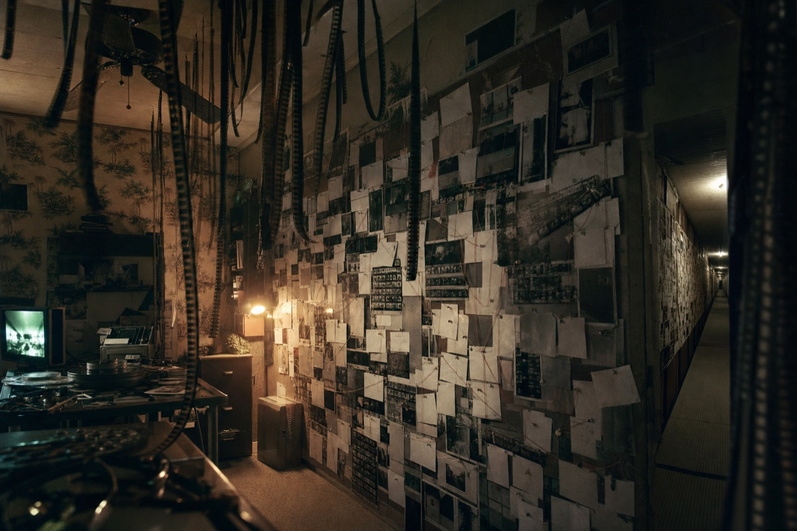

# Le montage en 2036

*Suite et révision de « Agent-Driven Editing » (février 2026). Six mois ont suffi à périmer sa conclusion principale.*

---

## Ce qui a été écrit en février, et ce qui est faux depuis

En février j'ai écrit qu'il manquait une pièce : un NLE headless conçu pour être piloté par des agents, avec OTIO comme modèle de timeline natif, MCP comme interface de contrôle, un moteur de rendu FFmpeg ou MLT, une vraie chaîne couleur. J'ai écrit : les pièces existent, personne ne les a assemblées.

Deux équipes les ont assemblées entre-temps. Palmier Pro, éditeur macOS écrit de zéro pour l'IA, expose un serveur MCP local avec plus de trente outils sur la timeline. OpenCut a fusionné en juillet une réécriture complète en Rust avec mode headless, système de plugins, onglet de scripting et serveur MCP. Le premier est sous GPLv3, donc contaminant et incompatible avec ma politique de licence. Le second est sous MIT.

La question n'est donc plus de construire. Elle est de brancher ou de forker. C'est une bonne nouvelle et une perte : la fenêtre où l'on pouvait faire de l'outil lui-même un geste d'auteur vient de se refermer, comme elle s'était refermée pour le NLE dans les années 1990. Ce qui reste à inventer est ailleurs, et c'est justement ce que ce texte cherche.

Deuxième révision. J'avais fait d'OTIO le pivot. OTIO n'a pas publié de version depuis novembre 2025, les keyframes restent absents du schéma, la couleur reste « en discussion ». Pendant ces neuf mois, tout le reste a bougé. Le format que j'avais choisi pour sa stabilité est stable au sens où un bâtiment classé est stable. Le contrôle réel, lui, est passé par MCP.

La conclusion pratique est bicéphale, et je la tiens pour les dix ans qui viennent : OTIO pour la vérité, celle qui se versionne, se diffe et survit aux logiciels ; MCP, ou son successeur, pour la main. Ne jamais confondre le format qui dure et le protocole qui agit. Quiconque fusionne les deux perdra les deux.

---

## Trois questions, trois réponses tranchées

### Un agent dirigera-t-il le montage ?

Non, et pas pour la raison qu'on croit. Ce n'est pas une question de capacité technique, c'est une question de vérifiabilité. Un agent progresse là où il existe un test qui dit vrai ou faux. Le code compile ou ne compile pas. Un cut est bon ou mauvais selon un jugement qui n'a pas de fonction de perte. On peut décrire un visage en JSON, on ne peut pas déduire d'un intervalle de timecode ce que fait à un spectateur le fait de tenir sur ce visage trois secondes de plus.

La recherche de 2026 confirme le mur au lieu de le déplacer. CineAgents nomme les deux modes d'échec du montage par modèle de langage : l'effondrement contextuel et la fragmentation temporelle. Sa réponse, une mémoire narrative hiérarchique et une planification itérative, fonctionne sur des compilations courtes avec des vérités de terrain annotées par des monteurs. Memories.ai attaque par l'indexation sémantique sur quatre cents vidéos. Aucun des deux ne prétend au long métrage. Le mur que j'avais situé au passage du rough cut au fine cut est exactement là où la recherche s'arrête.

Mais je maintiens la distinction qui compte davantage : l'agent ne remplace pas le monteur, il remplace l'assistant monteur. Dérushage, proxys, synchro, transcription, logging, conformation, contrôle qualité, livraison. Quarante à soixante pour cent du temps d'un montage, entièrement vérifiables par machine. C'est là qu'est le facteur mille. Le fine cut restera à peu près à un pour un, et c'est très bien.

### Y aura-t-il encore une timeline ?

Oui, et elle ressemblera moins à celle d'aujourd'hui qu'à ce qu'elle est déjà devenue sans qu'on le dise : une projection.

Le vrai déplacement est en cours et il est unanime. Resolve indexe, Premiere indexe, Jumper indexe en local, Kino et Strada indexent dans le nuage, Memories.ai en fait un objet de recherche. Tout le monde converge sur la même phrase : la base indexée est le projet. La timeline devient une vue sur un corpus, comme un tableur est une vue sur une base. Elle ne disparaît pas, elle cesse d'être le document maître.

Ce que cela change concrètement, je l'ai déjà éprouvé. Quatre-vingts pour cent du montage se fait hors de la timeline, devant un mur de post-it, dans des tableurs, dans de l'écriture. La timeline est l'endroit où l'on exécute une décision prise ailleurs. Un outil qui traite la timeline comme le document central optimise le lieu de l'exécution et laisse le lieu de la décision au papier. C'est l'erreur de conception de tous les NLE existants, et le point aveugle de tout le discours sur le montage agentique.

Donc en 2036 : un index sémantique comme socle, un espace de décision au-dessus (mur, graphe, courbe, peu importe la forme, il doit produire l'ordre et non l'analyser), une timeline en dessous comme projection exécutable et versionnée, et un moteur de rendu au fond. Quatre couches, pas une application.

### Le montage se fera-t-il dans le moteur temps réel ?

En partie, et il manque un adaptateur ridiculement petit. Unreal 5.7 a des agents (quarante-neuf outils MCP recensés), du Live Link réseau, des travaux de recherche sur les cinématiques automatiques. Il n'existe aucun pont documenté entre Sequencer et OTIO ou FCPXML. Pour quelqu'un qui travaille le machinima documentaire, ce n'est pas un chantier, c'est une pièce à écrire.

---

## Ce que je n'avais pas vu venir, et qui me met en difficulté

Voici le point le plus intéressant de ce texte, parce qu'il attaque une position que je tiens depuis longtemps.

J'ai écrit que le cut est le film. Le choix du moment, la décision de tenir, celle de couper au moment de la violence : ce sont des décisions de mise en scène, et un agent qui les prend ne monte pas, il génère du contenu.

Or l'édition en contexte change la nature de l'alternative. Aleph 2.0 réécrit une prise existante sans la regénérer : angle de caméra, lumière, heure du jour, ajout ou retrait d'objets, transfert de mouvement d'un plan à l'autre, en préservant le grain et la continuité. On corrige sur une seule image et le modèle propage. Et il traverse les cuts : une correction s'applique aux plans concernés d'une séquence entière.

Ce que cela fait au montage n'est pas anecdotique. Quand modifier un plan coûte moins cher que choisir entre deux plans, la question « quel plan » cède devant « quel plan je fabrique ». Le fonds de rushes cesse d'être une contrainte. Or le montage documentaire, tel que je le pratique, est un art de la contrainte : je monte avec ce qui a été capté, et c'est le manque qui fabrique la forme. Une matière infiniment malléable ne me libère pas, elle me retire l'adversaire.

Ma réponse n'est pas de refuser l'outil, elle est de le borner par déclaration. Le principe de l'ancrage indiciel substantiel se transpose au montage sans effort : ce qui est capté garde la dernière instance, et toute réécriture d'un plan est un geste déclaré, pas une commodité. Concrètement, dans l'outil : un plan réécrit porte sa trace dans la timeline, la timeline conserve la version captée, et le paratexte de provenance suit jusqu'à la livraison. Si je ne peux pas dire de quel régime relève un plan, l'outil est mal fait.

Il y a une seconde tension que mon texte de février n'avait pas résolue et que je tranche ici. J'y écrivais que la boucle à la Cursor ne fonctionne pas pour le montage, la rétroaction étant trop lente et trop coûteuse en information ; puis, deux sections plus loin, je redessinais la boucle complète avec un modèle multimodal qui regarde le preview. Les deux ne peuvent pas être vraies.

Ce qui les réconcilie est une question d'échelle de décision. La boucle automatisée fonctionne pour tout ce qui a un critère nommable : la continuité tient ou non, le raccord regard est correct ou faux, un visage apparaît là où il ne doit pas, un plan dépasse le budget de durée d'une séquence. Elle ne fonctionne pas pour le rythme, qui n'est pas une propriété du fichier mais un effet sur un corps. Donc : boucle fermée sur la vérification, boucle ouverte sur le jugement. Et c'est précisément le partage que ma règle de comité posait déjà : l'agent écrit des documents, il ne mute jamais la timeline.

Fait notable : cette boucle de vérification perceptive n'existe chez aucun produit du marché. Eddie, Descript, Adobe, Runway livrent tous en une passe et rendent la main. Le « recommence jusqu'à ce que ce soit tenable » est le seul endroit où un auteur seul avec des machines fait quelque chose qu'un éditeur logiciel ne fait pas, parce que ce n'est rentable pour personne d'autre.

---

## L'actif que personne ne peut acheter

Vojta Jina, ancien ingénieur d'AngularJS puis d'Apple, aujourd'hui à la tête du projet Ctuber, l'a formulé mieux que le reste du secteur en décembre 2025 : il n'existe presque aucune donnée structurée sur les décisions de montage. Personne ne possède le corpus des différences entre deux versions d'un cut accompagnées de la raison du changement. On trouve des films finis en quantité, on ne trouve pas le chemin qui y mène. C'est d'ailleurs pourquoi il refuse de construire un éditeur complet et attaque par une version étroite : le produit sert d'abord à collecter cette donnée-là.

Or ma manière de travailler fabrique mécaniquement ce corpus : les timelines versionnées en git, le mur de décision horodaté, les comptes rendus de comité qui disent pourquoi une version a été écartée. Ce n'est pas un sous-produit, c'est le seul actif de cette pratique que ni Adobe ni Blackmagic ni un laboratoire ne peut acheter, parce qu'il ne se collecte pas à l'échelle : il faut des années de montage réel d'une même personne pour qu'il ait un sens.

J'en tire une consigne de construction, et c'est peut-être la plus importante de ce texte : concevoir l'outil pour qu'il enregistre le pourquoi, pas seulement le quoi. Un système qui garde les versions sans garder les raisons perd exactement ce qui a de la valeur.

---

## L'architecture que je retiens pour mon outil

Quatre couches, faiblement couplées, chacune remplaçable. C'est la non-captivité appliquée au montage : aucune de ces briques ne doit pouvoir me retenir en otage.

**L'index.** Un enregistrement par segment, des vecteurs séparés pour le visuel, le dialogue et le son, en local, sur mes rushes. C'est la couche que les éditeurs de NLE sont en train d'internaliser, donc la fenêtre se referme côté produit, mais elle reste grande ouverte côté auteur : personne ne fera un index qui pense comme moi.

**Le mur.** L'espace où l'ordre se fabrique, distinct de l'analyse. Format ouvert, versionnable, lisible par un agent comme par moi. Il produit l'ordre, il ne le commente pas.

**La timeline.** OTIO comme vérité, versionnée en git, une version par état du film. MCP pour la main d'un agent dessus, avec la règle dure : l'agent propose des documents, je tranche, et rien ne mute sans moi.

**Le rendu.** FFmpeg et MLT pour la chaîne mécanique, et une sortie propre vers un NLE pour le dernier kilomètre. Ne pas chercher à finir dans mon outil. Tout le marché livre dans un NLE pour la finition, et ce n'est pas une faiblesse du marché, c'est la reconnaissance que l'étalonnage et le mix sont des gestes haptiques. Ma valeur est en amont : l'index, le mur, l'assemblage, le comité, la boucle de vérification. Le handoff doit être irréprochable, et c'est tout.

Une brique de plus, non fonctionnelle et non négociable : l'agent-rupture. Une fois par cycle de montage, une contrainte non auditée entre dans le système. Un plan qu'aucun critère ne justifie, un ordre que l'index n'aurait pas proposé. Un pipeline qui ne produit que de la cohérence produit du montage moyen avec beaucoup d'efficacité.

Et un garde-fou déjà gravé, à répéter parce qu'il sera la première chose qu'un outil bien intentionné cassera : en mode auteur, on ne supprime jamais les silences et on n'optimise jamais la durée. La suppression automatique des silences est le geste par défaut de tous les outils de montage par IA. C'est aussi la définition exacte de ce qui distingue un film d'un contenu.

---

## Ce que je crois vraiment sur 2036

Le montage ne sera pas dirigé par un agent, il sera entouré par eux. L'assistanat disparaît comme métier et revient comme couche logicielle. La timeline survit en se subordonnant à un index. Le lieu du travail se déplace vers l'amont, vers l'espace où l'on décide de l'ordre, qui est aussi le seul endroit où le cinéma se joue depuis toujours.

Ce qui me préoccupe n'est pas que les machines montent. C'est que la matière devienne infiniment corrigeable et que le montage cesse d'être un art de la contrainte pour devenir un art de la spécification. Contre cela, il n'y a pas d'argument technique, seulement une discipline : garder le capté au centre, déclarer chaque réécriture, et refuser de fabriquer le plan qui manque quand le manque est le sujet.

Une dernière remarque, plus stratégique qu'artistique. En février 2026, Xi Wang présentait à l'École polytechnique, dans le cadre de l'institut Hi! PARIS, une intervention intitulée « AI Cinema: are we ready for World + Observer? ». Sa thèse est juste : le cinéma ne consiste pas à générer des images, il consiste à structurer du sens par ce qui arrive et par la façon dont c'est observé. Le monde et l'observateur y sont posés comme les deux briques de l'IA-cinéma. Et il n'y est rien dit du montage. Le troisième terme manque, et la place est vide. Quand un discours institutionnel oublie le lieu où le sens se fabrique, ce n'est pas un oubli, c'est une infrastructure d'absences qu'il vaut la peine de nommer.

---

*Texte de position, pas de prédiction. Il sera faux quelque part, et c'est l'intérêt de le dater.*
