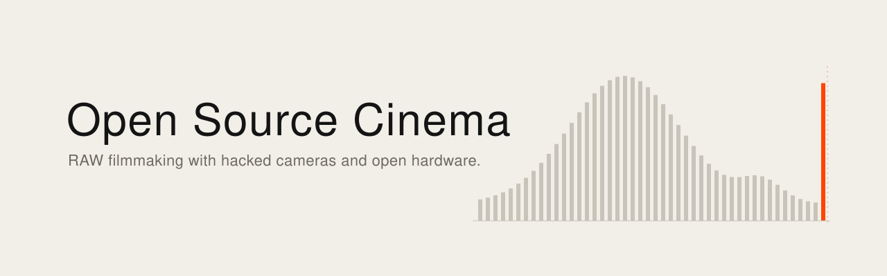
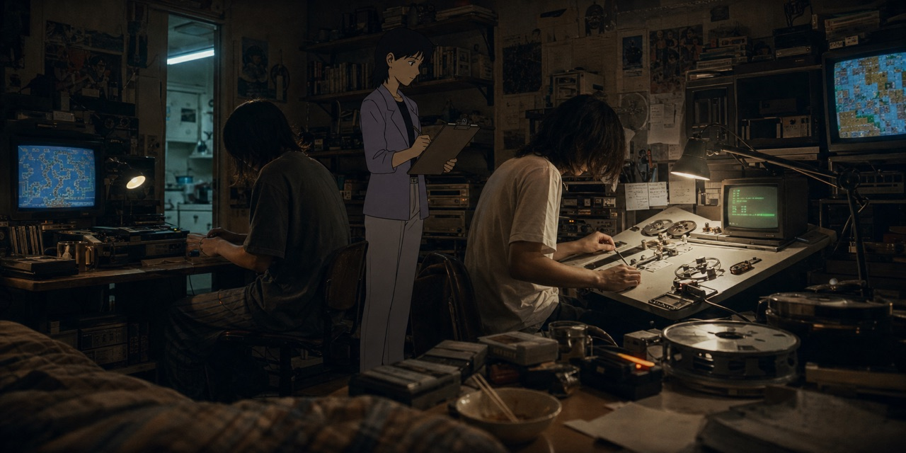
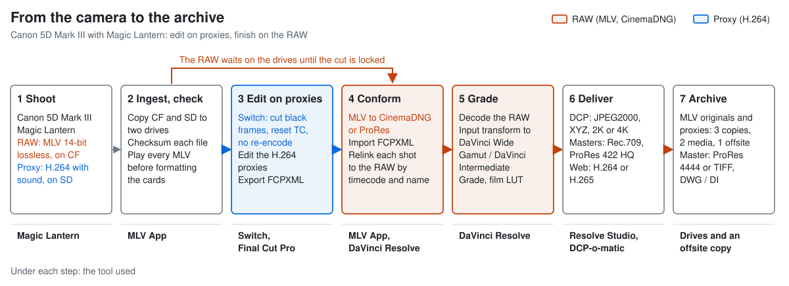
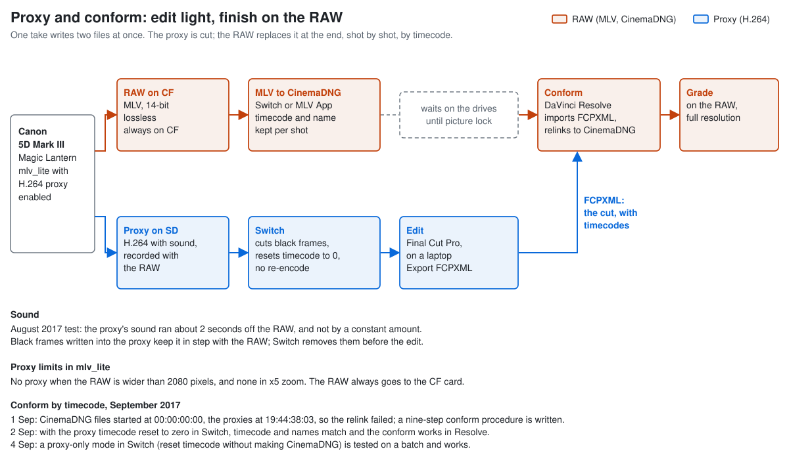

<picture><source media="(prefers-color-scheme: dark)" srcset="banner.svg"></picture>

[English](README.md) · **Français**

# Open Source Cinema

**Vidéo RAW avec Magic Lantern sur le Canon 5D Mark III, et postproduction avec des outils libres.**

## Qui je suis

Je suis Ismaël Joffroy Chandoutis, cinéaste et artiste, et je vis à Paris. Je fais des films entre documentaire, fiction et animation. [Maalbeek](https://en.unifrance.org/movie/50347/maalbeek) (2020) a été présenté en première à la Semaine de la Critique à Cannes, il a reçu le Prix André-Martin à Annecy en 2021 et le César du meilleur court métrage documentaire en 2022. Swatted (2018, Le Fresnoy) a reçu une mention d'honneur à Ars Electronica en 2019 et s'est qualifié pour les Oscars. [Ondes Noires](https://en.unifrance.org/movie/45236/dark-waves) (2017) a remporté le Grand Prix à Regensburg.

## Ce qu'est ce dépôt

Je tourne en vidéo RAW avec Magic Lantern sur le Canon 5D Mark III depuis 2013, l'année où la vidéo RAW est arrivée sur ce boîtier. Ce dépôt documente ma façon de travailler avec : la caméra, les cartes, le proxy enregistré avec le RAW, la conformation à partir du montage offline, l'étalonnage et la livraison. Il documente aussi la fabrication des nuages de points de Maalbeek à partir de plans-séquences en vidéo RAW. Des parties d'Ondes Noires ont elles aussi été tournées en RAW Magic Lantern, et montées avec des images Blackmagic et RED Dragon.

Je n'écris pas de code. Sur le forum de Magic Lantern, où je poste sous le nom de [12georgiadis](https://www.magiclantern.fm/forum/index.php?action=profile;u=24232), je teste les builds, je signale les problèmes et je demande ce dont un montage professionnel a besoin. Entre 2013 et 2022 j'y ai écrit 213 messages dans 37 fils, la plupart en 2017 et 2018. Les liens vers ces messages sont dans les chapitres, à côté de ce qu'ils montrent.

Chaque mode et chaque outil des chapitres est rangé dans un de ces trois groupes :

- **Ce avec quoi j'ai tourné** : utilisé sur un vrai tournage.
- **Fiable, sur ma liste d'essais** : d'autres le font marcher ou le code le permet, je ne l'ai pas encore utilisé sur un film.
- **Pas prêt** : ça existe, mais on ne peut pas tourner avec aujourd'hui.

Les chiffres renvoient à leur source, ou sont signalés comme mes propres estimations.

## Chapitres

Les chapitres sont en anglais.

| # | Chapitre | Ce qu'il contient |
|---|---|---|
| 00 | [La chaîne entière](docs/00-the-whole-chain.md) | Chaque étape d'un film, ce que j'y ai fait, et le dépôt ou le chapitre qui le documente |
| 01 | [Maalbeek : des nuages de points à partir de plans-séquences en vidéo RAW](docs/01-maalbeek-photogrammetry.md) | Comment les scans de Maalbeek ont été tournés en vidéo RAW puis transformés en nuages de points |
| 02 | [Magic Lantern sur le 5D Mark III](docs/02-magic-lantern-5d-mark-iii.md) | Builds, lecture du capteur, modes et débits, cartes, proxy H.264, aperçu et HDMI, Dual ISO, le 7D et l'EOS M |
| 03 | [Post-traitement du RAW](docs/03-raw-post-processing.md) | MLV App et les autres outils pour développer le RAW |
| 04 | [Offline, conformation et étalonnage](docs/04-offline-online-conform-and-grading.md) | Monter sur les proxys, conformer sur le RAW, étalonner dans Resolve |
| 05 | [Rendus pellicule et restauration](docs/05-film-looks-and-restoration.md) | Émulation de pellicule et restauration avec des outils libres |
| 06 | [Perspectives et liste d'essais](docs/06-outlook-and-test-list.md) | L'état de Magic Lantern en novembre 2026 et les essais qu'il me reste à faire |
| 07 | [AXIOM et le cinéma ouvert](docs/07-axiom-and-open-cinema.md) | La caméra de cinéma en matériel ouvert et où elle en est |
| 08 | [Livraison et archivage](docs/08-delivery-and-archiving.md) | DCP, masters et formats d'archive ouverts |
| 09 | [Les données du tournage](docs/09-on-set-data.md) | Copier et vérifier les rushes, de l'Inde en 2017 à mon protocole de sauvegarde |
| 10 | [Prévisualisation, 3D et images générées](docs/10-previs-3d-and-generated-images.md) | De Maalbeek à Blender, les outils que j'ai construits, les bancs que j'ai mesurés |
| 11 | [La chaîne libre : liste d'essais](docs/11-open-chain-test-list.md) | Les outils libres à essayer à chaque étape, le protocole et ce que je mesurerai |
| 12 | [Son et mixage](docs/12-sound-and-mixing.md) | Ce que j'ai fait du son, Ardour, et l'essai de mixage à faire |
| 13 | [Formats](docs/13-formats.md) | Les formats ouverts de la chaîne, le MLV dans Resolve et Final Cut Pro, les formats fermés et comment les logiciels libres les lisent |
| 14 | [ComfyUI, Wan2GP et Pinokio](docs/14-comfyui-wan2gp-pinokio.md) | Ce que j'ai installé, construit et mesuré en 2026 |
| 15 | [Conserver les films et les œuvres](docs/15-conserving-artworks.md) | self-hosted-film-lab, et les outils libres de la conservation des œuvres à médias |

## Ce qui a changé en novembre 2026

Le dépôt a été réécrit en novembre 2026. L'ancien README tenait en une seule longue page, il est maintenant découpé dans les chapitres ci-dessus. Les principaux changements :

- Maalbeek a son propre chapitre. L'ancien README citait le César de Maalbeek sans rien dire de l'usage du 5D Mark III sur le film.
- Les chiffres ont une source ou sont signalés. Les chiffres de dynamique du Dual ISO sont mes propres estimations, et c'est maintenant écrit. Les débits sont calculés, et la formule est donnée.
- Le mode 3:2 est corrigé. À 1920 de large, c'est du 1920x1280. L'ancien README écrivait 1920x1200, une taille que le menu de Magic Lantern ne propose pas. L'enregistrement continu sur la carte CF seule et la sortie HDMI propre dans ce mode restent à confirmer : ils sont sur la liste d'essais.
- Le proxy H.264 a une section entière, avec mes essais de 2017, les limites inscrites dans le code et la question du firmware.
- Mon activité sur le forum est décrite par ce que montrent les messages, avec un lien vers chacun. Je teste, je signale et je demande. Le code, ce sont les développeurs du projet qui l'écrivent.
- Les builds et les outils sont à jour : la version de Danne du 7 juin 2025, la seule version officielle de Magic Lantern depuis le retour de l'équipe, MLV App 1.16, et les nouveaux outils qui montent les fichiers MLV pour Resolve.
- Les parties périmées ont été retirées, comme ma liste de matériel de février 2026.
- Six schémas ont été ajoutés dans [schemas/](schemas/).

## Cité par CineD

En novembre 2026, Nino Leitner a parlé de ce dépôt dans [Magic Lantern for Canon DSLRs in 2026](https://www.cined.com/magic-lantern-canon-2026-raw-video-film-roll-soup-engine-m-film), sur CineD. Il y écrit que les chiffres de dynamique du Dual ISO étaient mes propres estimations, et il avait raison. Ils sont maintenant signalés comme tels.

## Monter avec des agents

Je monte dans Final Cut Pro piloté par des agents grâce à [SpliceKit](https://github.com/elliotttate/SpliceKit), un serveur MCP, et dans DaVinci Resolve Studio, qui embarque son propre serveur MCP depuis la [version 21.1](https://www.blackmagicdesign.com/media/partial/release/20260908-03). Je construis aussi mon propre logiciel de montage, pensé dès le départ pour l'IA et les agents, autour de deux gestes : couper et générer.

## Autres documents de ce dépôt

| Document | Ce que c'est |
|---|---|
| [ML RAW Workflows: DaVinci Resolve & Final Cut Pro](ML-RAW-Workflows-Resolve-FCP.md) | Le guide de workflow, plus long : CinemaDNG dans Resolve, arbres de nœuds, raccord entre caméras, DCP et IMF, aller-retour avec Final Cut Pro |
| [Agent-Driven Editing](Agent-Driven-Editing-2026.md) | Des agents IA qui pilotent les logiciels de montage, les serveurs MCP pour Resolve et Final Cut Pro, OpenTimelineIO (février 2026) |
| [Generative Pipeline: March 2026](Generative-Pipeline-March-2026.md) | La suite du document sur les agents : chaînes de génération vidéo et audio (mars 2026) |
| [The Film Comes First](Strategy-Film-First.md) | Pourquoi le film doit passer avant la chaîne technique (mars 2026) |
| [Le montage en 2036](Editing-2036.fr.md) | Essai en français, suite du document sur les agents, révisé six mois plus tard |
| [L'auteur est celui qui arrête](L-auteur-est-celui-qui-arrete.fr.md) | Essai en français : notes sur la coupe, écrites quand la génération vidéo est devenue plus rapide que le temps réel (août 2026) |

Les quatre documents en anglais sont datés et décrivent l'état des choses à cette date.

## Comment citer

Les métadonnées sont dans [CITATION.cff](CITATION.cff). GitHub en tire un bouton « Cite this repository ». Dans un texte :

> Joffroy Chandoutis, Ismaël. *Open Source Cinema.* GitHub repository, 2026. https://github.com/ismael-joffroy-chandoutis/open-source-cinema

Si vous citez un chiffre, merci de citer le chapitre d'où il vient et de dire s'il est signalé comme mon estimation.

## Licence

Cette documentation est publiée sous licence [CC BY-NC-ND 4.0](https://creativecommons.org/licenses/by-nc-nd/4.0/). Le texte complet est dans [LICENSE.md](LICENSE.md).

Les outils décrits ont chacun leur licence, par exemple :

- [Magic Lantern](https://github.com/reticulatedpines/magiclantern_simplified) : GPL v2
- [MLV App](https://github.com/ilia3101/MLV-App) : GPL v3
- [AXIOM / apertus](https://github.com/apertus-open-source-cinema) : GPL v3 (logiciel), CERN OHL (matériel)

Par [Ismaël Joffroy Chandoutis](https://ismaeljoffroychandoutis.com).
