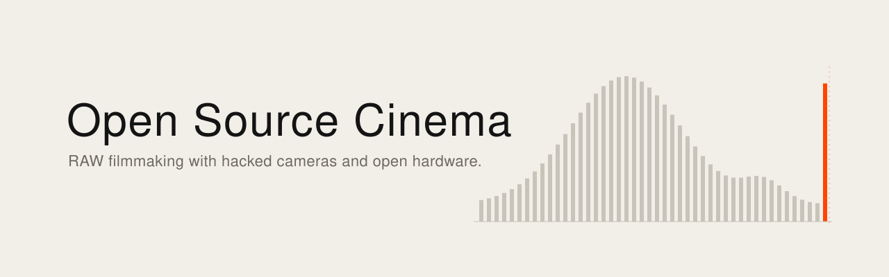
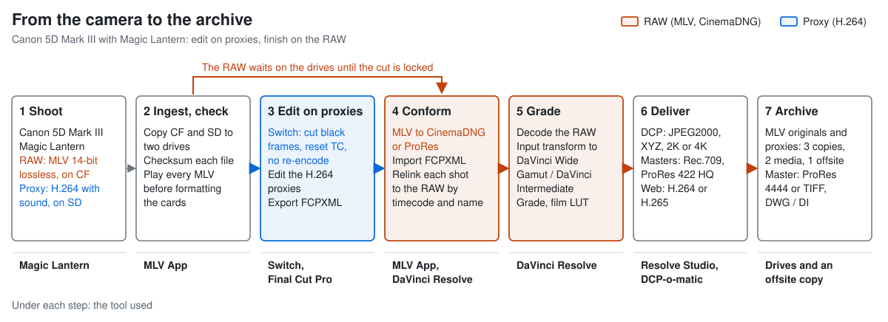
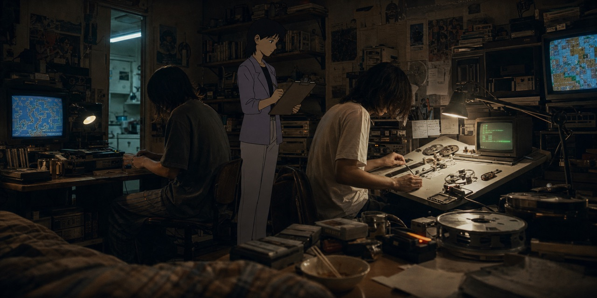
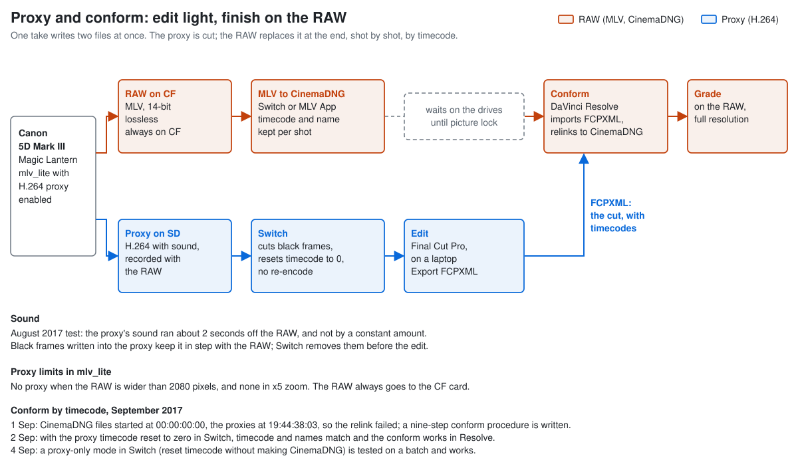

<picture><source media="(prefers-color-scheme: dark)" srcset="banner.svg"></picture>

**English** · [Français](README.fr.md)

# Open Source Cinema

**Making a film from writing to archive with open tools, at low cost, and where each step stands.**

## What this repository is

I shot RAW video on a Canon 5D Mark III with Magic Lantern, a free firmware, from 2013: a feature documentary in India in 2017, the scans of Maalbeek in 2019, parts of Ondes Noires. Today a used body of this camera sells for 249 to 489 € ([MPB France](https://www.mpb.com/fr-fr/produit/canon-eos-5d-mark-iii), about 100 bodies listed on 24 November 2026), and the firmware costs nothing.

Here I look at how far the rest of a film can go the same way, from writing to the cinema copy and the archive. It follows the steps of a film in order. For each step it says what I have done, with which tool, what it costs, and what I still have to test. The camera, Magic Lantern on the 5D Mark III, is one of these steps.

Every tool in the chapters is in one of three groups:

- **What I have shot with**: used on a real shoot.
- **Reliable, on my test list**: reported to work by others or by the code, not yet used by me on a film.
- **Not ready**: exists, but not usable on a shoot today.

Figures are linked to their source, or marked as my own estimate. A cost is given only where I found a price with a date; open tools are free to download unless the row says otherwise.

## The chain, step by step

| Step | Open tool, and where it stands | Closed tool used on my films | Cost of the open route | Chapters |
|---|---|---|---|---|
| Writing | Story Architect and Trelby: on my test list | | Free licences; Story Architect also has a paid version | [11](docs/11-open-chain-test-list.md) |
| Previs and storyboard | Blender and Krita: on my test list; a film set for generated shots, built in Blender: not ready | | Free | [10](docs/10-previs-3d-and-generated-images.md), [11](docs/11-open-chain-test-list.md) |
| Camera | Magic Lantern on the 5D Mark III: shot with, from 2013. AXIOM Beta, the open hardware camera: not ready | | Used 5D Mark III body: 249 to 489 € (MPB France, 24 November 2026). Firmware: free. AXIOM Beta Developer Kit: 3,990 € excluding VAT ([apertus°](https://www.apertus.org/pricelist.html), November 2026) | [02](docs/02-magic-lantern-5d-mark-iii.md), [06](docs/06-outlook-and-test-list.md), [07](docs/07-axiom-and-open-cinema.md) |
| On-set data | rsync (India, 2017), xxHash and rclone: used on my films. ASC MHL: on my test list | | Free | [09](docs/09-on-set-data.md) |
| RAW development | MLV App: used on my films. The new tools that mount MLV files for Resolve and Final Cut Pro: on my test list | | Free | [03](docs/03-raw-post-processing.md), [13](docs/13-formats.md) |
| Editing | Kdenlive, Shotcut, the Blender sequencer, OpenTimelineIO for the exchange: on my test list | Final Cut Pro | Free | [04](docs/04-offline-online-conform-and-grading.md), [11](docs/11-open-chain-test-list.md) |
| Grading | vkdt and Blender: on my test list. The step where I have found no open tool at the level I need | DaVinci Resolve | Free | [04](docs/04-offline-online-conform-and-grading.md), [05](docs/05-film-looks-and-restoration.md), [11](docs/11-open-chain-test-list.md) |
| Sound and mixing | Ardour: on my test list | Pro Tools (mix of a 30-minute documentary, 2017) | Ardour's source code is free; the ready-to-run builds on [ardour.org](https://ardour.org/download.html) are paid | [12](docs/12-sound-and-mixing.md) |
| 3D, photogrammetry, splats | COLMAP, Meshroom, OpenSplat, Blender and Godot: on my test list | Metashape and Unity (Maalbeek) | Free | [01](docs/01-maalbeek-photogrammetry.md), [10](docs/10-previs-3d-and-generated-images.md), [11](docs/11-open-chain-test-list.md) |
| Effects, compositing and animation | The Blender compositor: on my test list. Natron: not ready | EbSynth (Maalbeek, 2020: a beta version tested on the film, with feedback to its developers) | Free | [01](docs/01-maalbeek-photogrammetry.md), [11](docs/11-open-chain-test-list.md) |
| Generated images | ComfyUI: installed and measured on my machines in 2026. The models are open weights, which is not open source | | Free software; it needs a GPU | [10](docs/10-previs-3d-and-generated-images.md), [14](docs/14-comfyui-wan2gp-pinokio.md) |
| Subtitles | Subtitle Edit: on my test list | | Free | [11](docs/11-open-chain-test-list.md) |
| Cinema copy (DCP) | DCP-o-matic: used on my films, since 2017 | | Free | [08](docs/08-delivery-and-archiving.md) |
| Archive and conservation | RAWcooked, FFmpeg with FFV1 and Matroska: on my test list | | Free | [08](docs/08-delivery-and-archiving.md), [15](docs/15-conserving-artworks.md) |

Three chapters go across every step: [00. The whole chain](docs/00-the-whole-chain.md), the map of my repositories step by step; [11. The open chain: test list](docs/11-open-chain-test-list.md), how I will test each tool and what I will measure; [13. Formats](docs/13-formats.md), the open formats and how open software reads closed ones.

## Chapters

| # | Chapter | What is in it |
|---|---|---|
| 00 | [The whole chain](docs/00-the-whole-chain.md) | Every step of a film, what I have done on it, and the repository or chapter where it is documented |
| 01 | [Maalbeek: point clouds from RAW video long takes](docs/01-maalbeek-photogrammetry.md) | How the scans of Maalbeek were shot in RAW video and turned into point clouds |
| 02 | [Magic Lantern on the 5D Mark III](docs/02-magic-lantern-5d-mark-iii.md) | Builds, sensor readout, modes and data rates, cards, the H.264 proxy, preview and HDMI, Dual ISO, the 7D and the EOS M |
| 03 | [RAW post-processing](docs/03-raw-post-processing.md) | MLV App and the other tools to develop the RAW |
| 04 | [Offline, online conform and grading](docs/04-offline-online-conform-and-grading.md) | Edit on the proxies, conform on the RAW, grade in Resolve |
| 05 | [Film looks and restoration](docs/05-film-looks-and-restoration.md) | Film emulation and restoration with open tools |
| 06 | [Outlook and test list](docs/06-outlook-and-test-list.md) | The state of Magic Lantern in November 2026 and the camera tests I still have to do |
| 07 | [AXIOM and open cinema](docs/07-axiom-and-open-cinema.md) | The open hardware cinema camera and where it stands |
| 08 | [Delivery and archiving](docs/08-delivery-and-archiving.md) | DCP, masters and open archive formats |
| 09 | [On-set data](docs/09-on-set-data.md) | Copying and checking rushes, from India in 2017 to my backup protocol |
| 10 | [Previs, 3D and generated images](docs/10-previs-3d-and-generated-images.md) | From Maalbeek to Blender, the tools I built, the benches I measured |
| 11 | [The open chain: test list](docs/11-open-chain-test-list.md) | The open tools I want to try at each step, how I will test them, what I will measure |
| 12 | [Sound and mixing](docs/12-sound-and-mixing.md) | What I have done with sound, Ardour, and the mix test I will do |
| 13 | [Formats](docs/13-formats.md) | The open formats of the chain, MLV in Resolve and Final Cut Pro, closed camera formats and how open software reads them |
| 14 | [ComfyUI, Wan2GP and Pinokio](docs/14-comfyui-wan2gp-pinokio.md) | What I installed, built and measured in 2026 |
| 15 | [Conserving films and artworks](docs/15-conserving-artworks.md) | self-hosted-film-lab, and the open tools of media art conservation |

The chapters keep their numbers, so that links to them keep working. The table above gives the order of the chain.

## Who I am

I'm Ismaël Joffroy Chandoutis, a filmmaker and artist based in Paris; my films move between documentary, fiction and animation. [Maalbeek](https://en.unifrance.org/movie/50347/maalbeek) (2020) premiered at the Semaine de la Critique in Cannes, won the Prix André-Martin at Annecy in 2021 and the César for Best Documentary Short Film in 2022. Swatted (2018, Le Fresnoy) received an honorary mention at Ars Electronica in 2019 and qualified for the Academy Awards. [Ondes Noires](https://en.unifrance.org/movie/45236/dark-waves) (2017) won the Grand Prix in Regensburg.

I don't write code. On the Magic Lantern forum, where I post as [12georgiadis](https://www.magiclantern.fm/forum/index.php?action=profile;u=24232), I test builds, report problems and ask for what a professional edit needs. Between 2013 and 2022 I wrote 213 messages in 37 threads, most of them in 2017 and 2018. The links to these messages are in the chapters, next to what they show. I also tested a beta of EbSynth, a closed tool, for the 8K render of Maalbeek ([chapter 01](docs/01-maalbeek-photogrammetry.md)), and in 2020 I wrote for Fastvideo the specification of a GPU JPEG 2000 encoder for DCP ([chapter 08](docs/08-delivery-and-archiving.md)).

## Editing with agents

I edit in Final Cut Pro driven by agents through [SpliceKit](https://github.com/elliotttate/SpliceKit), an MCP server, and in DaVinci Resolve Studio, which has come with its own MCP server since [version 21.1](https://www.blackmagicdesign.com/media/partial/release/20260908-03). I'm also building my own editing software, designed for AI and agents from the start, around two actions: cut and generate.

## Cited by CineD

In November 2026, Nino Leitner wrote about this repository in [Magic Lantern for Canon DSLRs in 2026](https://www.cined.com/magic-lantern-canon-2026-raw-video-film-roll-soup-engine-m-film) on CineD. He wrote that the Dual ISO dynamic range figures were my own estimates, and he was right. They are now marked that way.

## What changed in November 2026

The repository was rewritten in November 2026. It started as one long page on RAW video with Magic Lantern; it now follows the steps of a film in order. Main changes:

- The repository now goes from writing to archive: writing, previs, on-set data, editing, grading, sound, 3D, effects and animation, generated images, subtitles, the DCP, the archive and the conservation of artworks. For most of these steps it is a test list: I haven't used an open tool on a film there yet.
- Maalbeek has its own chapter. The old README named the César for Maalbeek but said nothing about how the 5D Mark III was used for the film.
- Figures are sourced or marked. The Dual ISO dynamic range figures are my own estimates and are now written as such. Data rates are calculated and the formula is given.
- The 3:2 mode is corrected. At 1920 wide it is 1920x1280. The old README wrote 1920x1200, a size the Magic Lantern menu doesn't offer. Continuous recording on the CF card alone and clean HDMI output in this mode are not confirmed, and are on the test list.
- The H.264 proxy has a full section, with my tests from 2017, the limits in the code and the firmware question.
- My forum activity is described by what the messages show, with a link to each message. I test, report and ask; I don't develop.
- Builds and tools are updated: Danne's release of 7 June 2025, the one official Magic Lantern release since the team came back, MLV App 1.16, and the new tools that mount MLV files for Resolve.
- Out-of-date parts were removed, such as my hardware list of February 2026.
- Six diagrams were added in [schemas/](schemas/).

## Other documents in this repository

| Document | What it is |
|---|---|
| [ML RAW Workflows: DaVinci Resolve & Final Cut Pro](ML-RAW-Workflows-Resolve-FCP.md) | The longer workflow guide: CinemaDNG in Resolve, node trees, multi-camera matching, DCP and IMF, FCP round trip |
| [Agent-Driven Editing](Agent-Driven-Editing-2026.md) | AI agents controlling editing software, MCP servers for Resolve and Final Cut Pro, OpenTimelineIO (February 2026) |
| [Generative Pipeline: March 2026](Generative-Pipeline-March-2026.md) | Follow-up to the agent document: generative video and audio pipelines (March 2026) |
| [The Film Comes First](Strategy-Film-First.md) | Why the film has to come before the pipeline (March 2026) |
| [Le montage en 2036](Editing-2036.fr.md) | Essay in French, follow-up to the agent document, revised six months later |
| [L'auteur est celui qui arrête](L-auteur-est-celui-qui-arrete.fr.md) | Essay in French: notes on the cut, written when video generation became faster than real time (August 2026) |

The four English documents are dated and describe the state of things at that date.

## How to cite

Use the metadata in [CITATION.cff](CITATION.cff). GitHub shows a "Cite this repository" button from it. In text:

> Joffroy Chandoutis, Ismaël. *Open Source Cinema.* GitHub repository, 2026. https://github.com/ismael-joffroy-chandoutis/open-source-cinema

When you quote a figure, please quote the chapter it comes from and say if it is marked as my own estimate.

## License

This documentation is released under [CC BY-NC-ND 4.0](https://creativecommons.org/licenses/by-nc-nd/4.0/). Full terms in [LICENSE.md](LICENSE.md).

The tools described are under their own licenses, for example:

- [Magic Lantern](https://github.com/reticulatedpines/magiclantern_simplified): GPL v2
- [MLV App](https://github.com/ilia3101/MLV-App): GPL v3
- [DCP-o-matic](https://dcpomatic.com/): GPL v2
- [Ardour](https://ardour.org/): GPL v2
- [Blender](https://www.blender.org/): GNU GPL
- [AXIOM / apertus](https://github.com/apertus-open-source-cinema): GPL v3 (software), CERN OHL (hardware)

By [Ismaël Joffroy Chandoutis](https://ismaeljoffroychandoutis.com).
