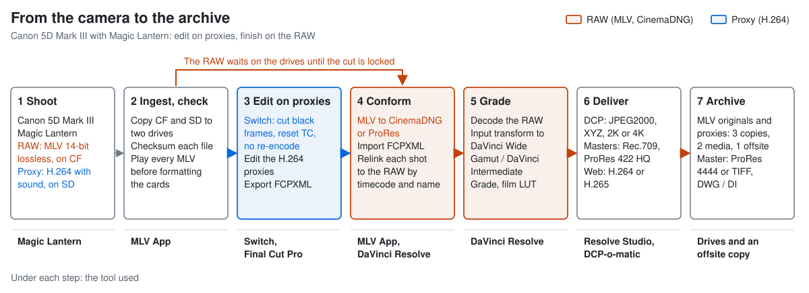

# 00. The whole chain

[Back to the README](../README.md) · Next: [01. Maalbeek: point clouds from RAW video long takes](01-maalbeek-photogrammetry.md)

This repository started with the camera: Magic Lantern RAW on the 5D Mark III. But a film goes through many more steps before it reaches a screen, and I have worked on most of them with open tools, or written down what I did with closed ones. That work is spread over several of my repositories. This page is the map: each step of the chain, what I have done on it, and where it is documented.

The three groups used in the chapters (**What I have shot with**, **Reliable, on my test list**, **Not ready**) are defined in the [README](../README.md). The open tools I haven't used yet, step by step, are in [11. The open chain: test list](11-open-chain-test-list.md).

Last checked: 24 November 2026.

## The steps

| Step | What I have done | Where it is documented |
|---|---|---|
| Writing and development | I write and research with agents, in files I keep on my own disks | [ai-cinema-method](https://github.com/ismael-joffroy-chandoutis/ai-cinema-method), [agentic-cli-filmmaker](https://github.com/ismael-joffroy-chandoutis/agentic-cli-filmmaker) |
| Previs | A film set for generated shots, with the camera move made in Blender; Blender render passes used to guide image generation | [spritz](https://github.com/ismael-joffroy-chandoutis/spritz), [comfyui-blender-temporal](https://github.com/ismael-joffroy-chandoutis/comfyui-blender-temporal), [10. Previs, 3D and generated images](10-previs-3d-and-generated-images.md) |
| Shooting | Magic Lantern RAW on the 5D Mark III since 2013: a feature documentary in India in 2017, the scans of Maalbeek in 2019, parts of Ondes Noires | [01](01-maalbeek-photogrammetry.md), [02](02-magic-lantern-5d-mark-iii.md), [07](07-axiom-and-open-cinema.md) |
| On-set data | Cards copied and checked with a checksum every evening in India in 2017; a backup protocol with xxHash and ASC MHL; a storage calculator | [09. On-set data](09-on-set-data.md), [dit-backup-protocol](https://github.com/ismael-joffroy-chandoutis/dit-backup-protocol), [shoot-storage-calculator](https://github.com/ismael-joffroy-chandoutis/shoot-storage-calculator) |
| RAW development | MLV App, MLVFS, Switch, and the corrections in the order I apply them | [03](03-raw-post-processing.md) |
| Editing | Offline edit on the H.264 proxies and conform on the RAW (2017); edits driven by agents; a measure of how dialogue scenes are cut | [04](04-offline-online-conform-and-grading.md), [editing-tools-atlas](https://github.com/ismael-joffroy-chandoutis/editing-tools-atlas), [dialogue-cut-meter](https://github.com/ismael-joffroy-chandoutis/dialogue-cut-meter), [prproj-downgrader](https://github.com/ismael-joffroy-chandoutis/prproj-downgrader) |
| 3D and effects | The point clouds of Maalbeek, from RAW video long takes | [01](01-maalbeek-photogrammetry.md), [10](10-previs-3d-and-generated-images.md) |
| Generated images | Image and video generation on my own machines, with measured tests | [10](10-previs-3d-and-generated-images.md), [comfyui-cinema-pipeline](https://github.com/ismael-joffroy-chandoutis/comfyui-cinema-pipeline), [local-ai-studio-guides](https://github.com/ismael-joffroy-chandoutis/local-ai-studio-guides), [ai-upscaler-benchmark](https://github.com/ismael-joffroy-chandoutis/ai-upscaler-benchmark) |
| Sound | Sound recorded in the camera with the RAW; a 30-minute documentary whose sound was edited and mixed in Pro Tools; voice repair for documentary recordings | [04](04-offline-online-conform-and-grading.md), [cinema-ai-toolkit](https://github.com/ismael-joffroy-chandoutis/cinema-ai-toolkit), [oscli](https://github.com/ismael-joffroy-chandoutis/oscli) |
| Grading | DaVinci Resolve since version 14, on CinemaDNG; ML RAW matched with Blackmagic and RED footage | [04](04-offline-online-conform-and-grading.md), [05](05-film-looks-and-restoration.md) |
| Cinema copy (DCP) | DCP-o-matic; a written specification for a JPEG 2000 encoder in 2020; a DCP test chain that passes two validators | [08](08-delivery-and-archiving.md), [self-hosted-film-lab](https://github.com/ismael-joffroy-chandoutis/self-hosted-film-lab) |
| Distribution | Screeners and online delivery codecs | [08](08-delivery-and-archiving.md), [self-hosted-film-lab](https://github.com/ismael-joffroy-chandoutis/self-hosted-film-lab) |
| Archiving | Open archive formats and what to keep from a film | [08](08-delivery-and-archiving.md), [self-hosted-film-lab](https://github.com/ismael-joffroy-chandoutis/self-hosted-film-lab) |
| Publishing the method | 213 messages on the Magic Lantern forum between 2013 and 2022; this repository; the other repositories on this page | [README](../README.md) |

## Where the chain is open, and where it is closed

In my own work today, these steps run on open tools: the camera firmware (Magic Lantern), RAW development (MLV App), the copies and checksums on set, the DCP (DCP-o-matic) and the archive formats. Image generation runs in ComfyUI, which is open; the models are open weights, which is something else (see below).

These steps run on closed tools: the edit (Final Cut Pro), the grade (DaVinci Resolve), the sound mix (Pro Tools in 2017), and the photogrammetry and real-time render of Maalbeek (Metashape and Unity).

The grade is the step where I have found no open tool at the level I need. The edit and the mix have open candidates that I haven't tried on a film. Both are in the [test list](11-open-chain-test-list.md).

## Open weights are not open source

Many image and video models can be downloaded and run on your own machine. That doesn't make them open source: the licence of a model often limits who can use it and for what, and the training data is rarely published. I keep the word "open" for tools under a free licence, and say "open weights" for models. The licences of the generative models I use are in [modeles-ia-cinema-2026](https://github.com/ismael-joffroy-chandoutis/modeles-ia-cinema-2026) (in French).

[Back to the README](../README.md) · Next: [01. Maalbeek: point clouds from RAW video long takes](01-maalbeek-photogrammetry.md)
