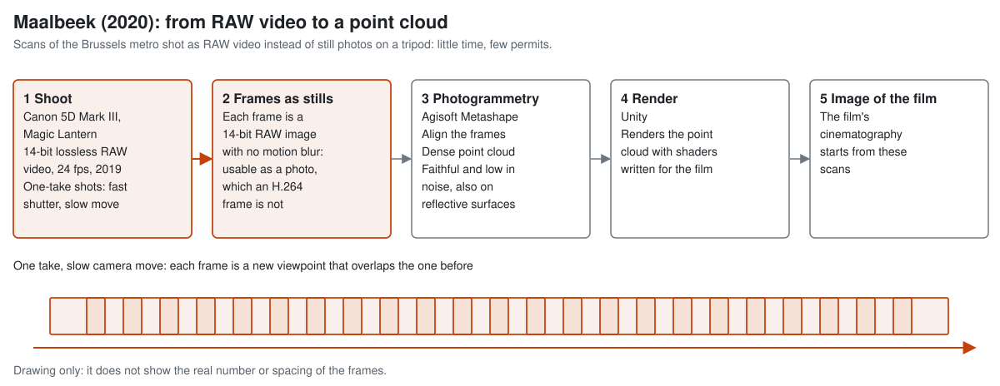

# 01. Maalbeek: point clouds from RAW video long takes

[Back to the README](../README.md) · Previous: [00. The whole chain](00-the-whole-chain.md) · Next: [02. Magic Lantern on the 5D Mark III](02-magic-lantern-5d-mark-iii.md)

## The film

On 22 March 2016, a bomb exploded in a metro train at Maalbeek station in Brussels. Sabine was seated behind the bomber. She woke up from a coma three months later with no memory of the explosion. The film follows her search for an image of an event she can't remember.

[Maalbeek](https://en.unifrance.org/movie/50347/maalbeek) (2020, 16 min) is a hybrid short, between documentary and animation. It premiered at the Semaine de la Critique in Cannes in 2020 and won the César for Best Documentary Short Film in 2022. Production: Films Grand Huit and Films à Vif.

The film uses point cloud animation, together with archive footage and CCTV images. The point clouds come from scans of places: the places of Sabine's trauma, and places that are symbolic for her. The whole cinematography of the film was built from these scans. This chapter explains how I made them with a Canon 5D Mark III recording RAW video with Magic Lantern.

## Why RAW video and not photos

The usual method for photogrammetry is photos on a tripod, with overlap between each photo. In the metro I didn't have the time for this and I had very few authorisations, so I filmed instead.

I shot the scans in 2019, alone, on the 5D Mark III with Magic Lantern. From memory: 1920x1280 (3:2) and 1920x1080, 14-bit lossless, 24 fps.

The method:

- a fast shutter speed, so there is no motion blur in the frames;
- I move slowly, in long takes;
- every frame of the take is then usable like a photo.

This doesn't work with the H.264 the camera records by default. A 14-bit RAW frame keeps the sensor data of each image. The camera's H.264 is 8-bit and compressed, so each frame carries much less colour information.

## From frames to point cloud

I did the photogrammetry in [Agisoft Metashape](https://www.agisoft.com/). The colour depth of the RAW gave a lot of information to work with. The point cloud was faithful and not scattered, and it held even on reflective surfaces.

The point clouds were then rendered in Unity, with custom shaders written for the film.

## What I tried before

Before the 5D Mark III, I tried an Insta360 Pro 2, a professional 8K 360 camera that records a compressed codec. Even in log and with LUTs, the point cloud I got was poorer: more scattered, with less texture and less information. The RAW from the 5D Mark III was much better for this.

On the 5D Mark III, I also tried the 3.5K mode, higher frame rates and the crop modes. I didn't keep them for the film. The modes are described in [chapter 02](02-magic-lantern-5d-mark-iii.md).

## My usual RAW cleanup

The corrections I use on Magic Lantern footage in general: vertical stripe correction in MLV App and the other tools of the period, dark frame subtraction (mostly on the 7D), and [Neat Video](https://www.neatvideo.com/) for denoising. Neat Video is commercial software. I think it's excellent and it's part of my chain. The full RAW processing is in [03-raw-post-processing.md](03-raw-post-processing.md).

## What is not documented here

I don't have the following details written down, so I don't give them: the exact Magic Lantern build, the number of frames per scan, how many frames I extracted per second, and the Metashape settings. If I find them in the project files, I will add them.

## How I would do it today (not tried)

This part is not something I have done. It's what I would test if I scanned the same places in 2026.

- **[COLMAP](https://colmap.github.io/changelog.html)** for camera poses. Version 4.0 (14 March 2026) integrates GLOMAP, the global mapper that was before a separate project.
- **Gaussian splatting** in place of a point cloud, trained with [gsplat](https://github.com/nerfstudio-project/gsplat), [Brush](https://github.com/ArthurBrussee/brush) or [Postshot](https://www.jawset.com/shop/pricing). The Studio version of Postshot accepts DNG/RAW as input and trains in 16 or 32 bits, which fits RAW video frames exported as CinemaDNG.
- **Metashape** is still developed: version 2.3.2 came out on 25 August 2026.

[Back to the README](../README.md) · Previous: [00. The whole chain](00-the-whole-chain.md) · Next: [02. Magic Lantern on the 5D Mark III](02-magic-lantern-5d-mark-iii.md)
