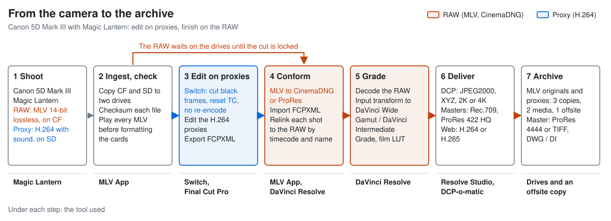
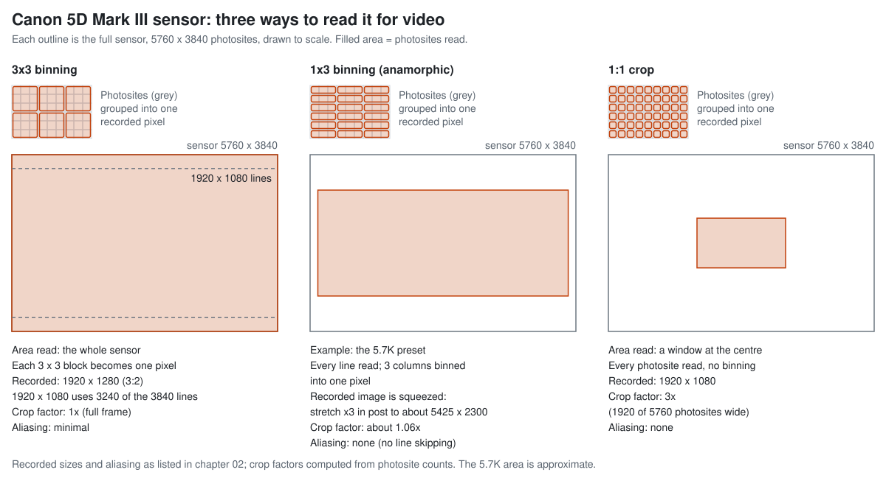
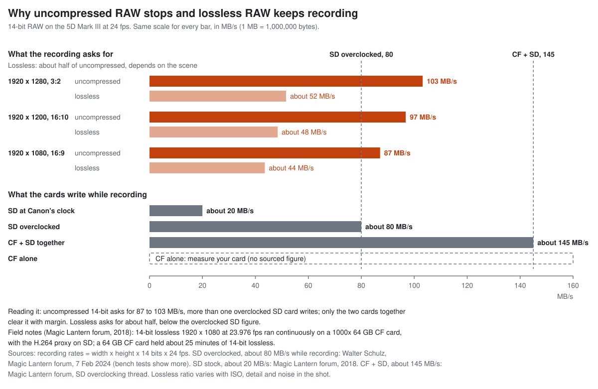
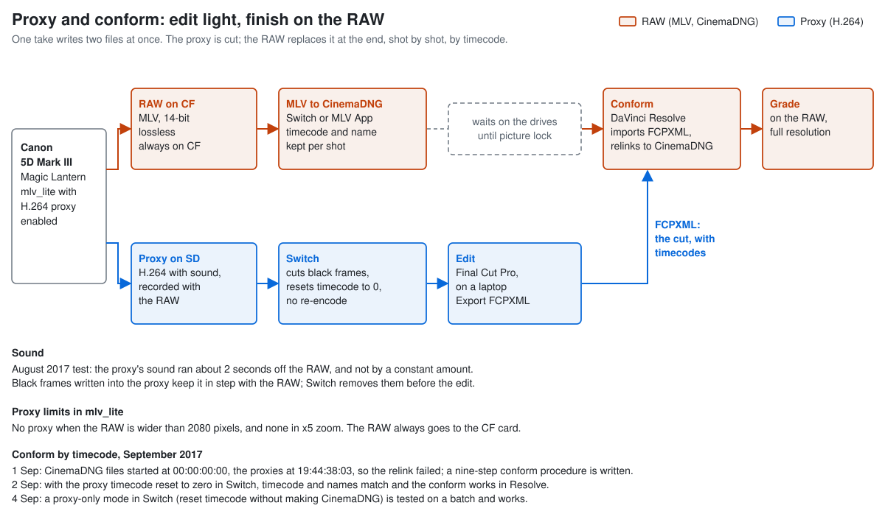

# 02. Magic Lantern on the Canon 5D Mark III

[Back to the README](../README.md) · Previous: [01. Maalbeek](01-maalbeek-photogrammetry.md) · Next: [03. RAW post-processing](03-raw-post-processing.md)

## Summer 2017, India

In the summer of 2017 I shot a feature documentary in India on the 5D Mark III, in RAW with Magic Lantern. I wrote on the forum from there on 13 August ([#25](https://www.magiclantern.fm/forum/index.php?topic=20025.msg188477#msg188477)) and arrived in Bangalore on 2 September ([#50](https://www.magiclantern.fm/forum/index.php?topic=15108.msg189529#msg189529)). The setup I described at the time: 14-bit compressed RAW in 1920x1080 at 24p ([#17](https://www.magiclantern.fm/forum/index.php?topic=15108.msg187677#msg187677)), with H.264 proxies with sound recorded at the same time ([#34](https://www.magiclantern.fm/forum/index.php?topic=20025.msg188610#msg188610)).

I shot almost everything on a monopod, with an electronic viewfinder, with the 24-105 mm f/4 and a little with the 50 mm f/1.8. It was 40 °C some days. The camera showed its temperature warning, and it kept recording.

This shoot is the reason for the work I did with Danne that summer: edit on the proxies as soon as the cards come out of the camera, then conform on the RAW. That part is in [04-offline-online-conform-and-grading.md](04-offline-online-conform-and-grading.md). This chapter is about the camera side.

I have used Magic Lantern seriously since 2013, when RAW video arrived on the 5D Mark III. Before that I did a few quick tests on the 550D and the 7D, mainly to remove the 30-minute recording limit and to raise the H.264 bitrate.

In this repository, every mode and tool is in one of three groups:

- **What I have shot with**: used on a real shoot.
- **Reliable, on my test list**: reported to work by others or by the code, not yet used by me on a film.
- **Not ready**: exists, but not usable on a shoot today.

## Why RAW on this camera

Canon records 8-bit H.264 (ALL-I or IPB) on the 5D Mark III. With Magic Lantern the same camera records the sensor data in 14 bits. For grading this is a very big difference: you can push exposure and colour much further before the image breaks.

| | Canon H.264 | ML RAW 14-bit | ML RAW + Dual ISO |
|---|---|---|---|
| Bit depth | 8-bit | 14-bit | 14-bit |
| Codec | H.264, lossy | Uncompressed or lossless (LJ92) | Two ISO levels interlaced, merged in post |
| Dynamic range | about 10 to 11 stops | about 12 to 13 stops | about 14 stops |

The dynamic range figures are my own estimates, not measurements. For measured curves, see the [Photons to Photos charts for Magic Lantern Dual ISO](https://www.photonstophotos.net/Charts/PDR_MagicLantern.htm).

## The project and the builds

Magic Lantern is a program that runs alongside Canon's firmware. It loads from the memory card each time the camera starts. The one permanent change is a flag that lets the camera boot from the card, and it can be reversed ([official repository](https://github.com/reticulatedpines/magiclantern_simplified)).

**Official project.** Since the team came back in 2025, there has been one official release, the "Midsummer" builds of June 2025 ([forum announcement](https://www.magiclantern.fm/forum/index.php?topic=27315.0); [CineD report](https://www.cined.com/magic-lantern-is-back-and-supports-new-cameras-such-as-eos-200d-6d-mark-ii-and-7d-mark-ii/)). The code keeps moving on the `dev` branch of [reticulatedpines/magiclantern_simplified](https://github.com/reticulatedpines/magiclantern_simplified), but nothing newer has been published as a build.

**The build I use: Danne's crop_rec_4k.** Danne's old builds on Bitbucket were deleted; he said it on the forum on 7 January 2026 ([thread](https://www.magiclantern.fm/forum/index.php?topic=23041.0)). His current builds are on GitHub: release [v1 of 7 June 2025](https://github.com/dannephoto/magic-lantern_dannephoto/releases/tag/v1), with two files, `crop_rec_4k_mlv_snd_isogain_1x3_presets_2025Jun07` for Canon firmware 1.1.3 and for 1.2.3. It includes the crop mode presets, lossless compression, MLV sound, ISO gain and the 1x3 anamorphic presets.

**Other fork.** [arnaud-sintes' fork](https://github.com/arnaud-sintes/magiclantern_asintes/releases) (last release 27 March 2024) adds a faster framed preview, focus sequencing and free-space display for both cards. Danne's June 2025 release is more recent.

| Canon firmware | Danne's build file (7 June 2025) |
|---|---|
| 1.1.3 | `crop_rec_4k_mlv_snd_isogain_1x3_presets_2025Jun07.5D3113` |
| 1.2.3 | `crop_rec_4k_mlv_snd_isogain_1x3_presets_2025Jun07.5D3123` |

The firmware version matters for the proxy, see below.

**Modules to activate:** `mlv_lite.mo` (RAW recording), `mlv_snd.mo` (sound), `crop_rec.mo` (crop modes and presets), `dual_iso.mo`, `sd_uhs.mo` (SD overclock), `file_man.mo`, `mlv_play.mo`. In the official source, `sd_uhs` was renamed `sd_clock` on [11 September 2026](https://github.com/reticulatedpines/magiclantern_simplified/commit/4dca98d6327e1ca4384bd00c935f08a317a93112); in Danne's 2025 build it still has its old name.

## Sensor readout modes

The sensor has 5760x3840 pixels, a 3:2 ratio. It is too much data to read in full at video frame rates, so the camera reduces it. Magic Lantern gives access to several ways of doing this.

| Readout | How it works | What you get |
|---|---|---|
| **3x3 binning** | Groups of 3x3 pixels combined, over the full width | Full-frame image around 1920 wide, soft, little aliasing on the 5D3. This is Canon's own 1080p mode |
| **1x3 binning** | Pixels combined in one direction only | Anamorphic image, to stretch in post |
| **1:1 crop** | Every pixel read, in a smaller area of the sensor | Sharp per-pixel image, with a crop factor |
| **Line skipping** | Lines are skipped instead of combined | Moiré and aliasing. This is what the 7D and the small Canon bodies do in their normal video mode |

## Resolution modes and data rates

The data rate column is calculated, not measured: width × height × bit depth ÷ 8 × frame rate, for **14-bit uncompressed** at 24 fps, in MB/s (1 MB = 1,000,000 bytes). Lossless compression (LJ92) reduces this. I estimate the saving at roughly half, depending on ISO and image (my own estimate). One real number, from what I wrote on the forum in 2018: 14-bit lossless gave me about 25 minutes on a 64 GB CF card ([#177](https://www.magiclantern.fm/forum/index.php?topic=22895.msg207058#msg207058)), which is around 43 MB/s on average.

| Mode | Resolution | Recorded as | 14-bit uncompressed, 24 fps | Preview on the camera | Group |
|---|---|---|---|---|---|
| 1080p full frame | 1920x1080 | 14-bit lossless, 24 fps | 87 MB/s | Colour, real time | What I have shot with |
| 16:10 full frame | 1920x1200 | 14-bit lossless, 24 fps | 97 MB/s | Colour, real time | What I have shot with |
| 3:2 full frame | 1920x1280 | 14-bit lossless, 24 fps | 103 MB/s | Colour, real time | Reliable, on my test list |
| 1080p 45/48 | 1920x1080 | lower bit depth or lossless | 87 MB/s (174 MB/s at 48 fps) | Limited | Reliable, on my test list |
| 3.5K crop | 3584x1320 | 10-bit lossless | 199 MB/s (142 MB/s in 10-bit) | Slow, greyscale | Reliable, on my test list |
| 5.7K anamorphic | 1x3 binning, stretched in post | 10-bit lossless | not calculated | Slow, greyscale, framing offset | Not ready |
| Full sensor | 5760x3840 | 14-bit | not usable as video | None | Not ready |

I tried the 3.5K mode, higher frame rates and the crop modes during the Maalbeek scans. I didn't keep them for the film ([chapter 01](01-maalbeek-photogrammetry.md)).

## The 3:2 mode

3:2 is the native ratio of the sensor. At 1920 wide, 3:2 is **1920x1280**. 1920x1200 is a 16:10 frame, not 3:2. I have shot in 1920x1200; whether I also used 1920x1280 is a point I still have to check in my files.

What I can say about 3:2 today:

- **Full frame, 3x3 binning, colour preview.** Like the 1080p mode, it keeps the full width of the sensor and a real-time colour image on the camera screen.
- **Continuous on a single CF card is not confirmed.** Uncompressed, 1920x1280 at 14 bits and 24 fps needs 103 MB/s. With lossless compression it needs less, but how long the camera records on the CF alone has to be measured. It's on my [test list](06-outlook-and-test-list.md).
- **HDMI output in this mode is not confirmed.** I have not recorded 3:2 with an external monitor plugged in. This is on my test list too.
- **The H.264 proxy is allowed by the code.** The proxy is switched off only above 2080 pixels wide or in x5 zoom ([mlv_lite.c](https://github.com/reticulatedpines/magiclantern_simplified/blob/cb1783df88de6634f2e480658e0d34a227b29f22/modules/raw_video/mlv_lite/mlv_lite.c#L1300-L1351)). 1920x1280 is under the limit. Nobody has reported it working with the proxy yet.

3:2 gives room in post: crop to 16:9 with headroom, or to 2.39:1.

## Cards

The 5D Mark III has a CF slot and an SD slot.

**CF.** The RAW goes on the CF. In 2018 I used a 1000x 64 GB CompactFlash for the RAW and the SD for the proxy ([#114](https://www.magiclantern.fm/forum/index.php?topic=16040.msg195587#msg195587)). The real write speed of the CF in the camera, for each mode, is something I want to measure rather than quote.

**SD, stock.** Canon runs the SD slot slowly. In 2018 I noted about 20 MB/s ([#112](https://www.magiclantern.fm/forum/index.php?topic=16040.msg195575#msg195575)). That is enough for the H.264 proxy, not for RAW.

**SD, overclocked.** The `sd_uhs` module raises the SD clock. Presets exist up to 240 MHz ([SD overclocking thread](https://www.magiclantern.fm/forum/index.php?topic=25841.0), [240 MHz preset](https://www.magiclantern.fm/forum/index.php?topic=26634.0)). At 240 MHz, Walter Schulz measured on the 5D3 "90+ MByte/s in benchmark and around 80 MByte/s in recording" (forum, 7 February 2024, [thread 27104](https://www.magiclantern.fm/forum/index.php?topic=27104.0)). Overclocking goes beyond the specification of the camera controller and, at 240 MHz, of the card: use as much as you need and no more. Compatible cards are listed on the [wiki](https://wiki.magiclantern.fm/cards_240mhz).

**Writing on both cards (card spanning).** Recording on the CF and the overclocked SD at the same time adds the two speeds; Walter Schulz gives about 145 MB/s in total (same thread). This is what makes the higher modes possible. In the official code, the SD overclock module was added to the release packages on [14 September 2025](https://github.com/reticulatedpines/magiclantern_simplified/commit/9c1cd0a3c910313f30d0dbdfe5a4035cf3c32538) and card spanning came into `mlv_lite` on [30 September 2025](https://github.com/reticulatedpines/magiclantern_simplified/commit/f0dc17db9bad4c6058901452c1ac448e0ba6c91a). No official build has been published since, so in practice these features come from community builds such as Danne's.

Format the cards in ExFAT (option in the Magic Lantern menu), so files are not split at 4 GB.

## The H.264 proxy recorded with the RAW

On the 5D Mark III, Magic Lantern can record an H.264 file with sound at the same time as the RAW. The RAW goes on the CF, the H.264 on the SD.

On 13 August 2017, in India, I tested "H264 proxy with sound + 1080p compressed raw and it works perfectly" ([#21](https://www.magiclantern.fm/forum/index.php?topic=19300.msg188451#msg188451)). The sound of the proxy was about 2 seconds off from the RAW, and the offset was not regular. On 26 August, a1ex posted a way to sync the proxy with the RAW by making the extra frames black ([#40](https://www.magiclantern.fm/forum/index.php?topic=19300.msg189190#msg189190)). The proxies then go through Danne's Switch to cut the black frames and reset the timecode, without re-encoding. That is the conform part, in [chapter 04](04-offline-online-conform-and-grading.md).

One practical problem I had: the camera asked to select the SD card again at each power-on. I solved it by switching off that option in the Magic Lantern menu ([#43](https://www.magiclantern.fm/forum/index.php?topic=15108.msg189348#msg189348), [#45](https://www.magiclantern.fm/forum/index.php?topic=15108.msg189372#msg189372)).

The proxy also helps on set: you can play back the take in real time and judge the performance, which matters with actors ([#98](https://www.magiclantern.fm/forum/index.php?topic=25880.msg195495#msg195495), [#109](https://www.magiclantern.fm/forum/index.php?topic=16040.msg195542#msg195542)).

**Limits of the proxy:**

- It works well on the 5D Mark III and not on the other bodies. dfort, 2018: "H.264 proxy has never been reliable on the EOSM or any other camera other than the 5D3" ([#103](https://www.magiclantern.fm/forum/index.php?topic=9741.msg195504#msg195504)). On my EOS M, the proxy froze ([#180](https://www.magiclantern.fm/forum/index.php?topic=9741.msg207085#msg207085)).
- The code switches it off above 2080 pixels wide and in x5 zoom, and warns that "RAW is always saved on CF" ([mlv_lite.c](https://github.com/reticulatedpines/magiclantern_simplified/blob/cb1783df88de6634f2e480658e0d34a227b29f22/modules/raw_video/mlv_lite/mlv_lite.c#L1300-L1351)).
- The firmware version makes a difference. Bilal reported 1920x1080 at 30 fps, 14-bit lossless with the H.264 proxy, for more than 3 minutes on firmware 1.2.3, with RAW sound switched off; on 1.1.3 he expected it to stop after a few seconds (forum, 5 August 2022, [thread 23041](https://www.magiclantern.fm/forum/index.php?topic=23041.0)).

Group: **What I have shot with** in 1080p. With 3:2: **Reliable, on my test list**.

## Preview and HDMI

In the 3x3 binning modes (1080p, 16:10, 3:2) the camera shows a real-time colour image. In the crop modes, the preview is a slow software view in greyscale: arnaud-sintes explained in April 2024 that only the native resolution has the hardware real-time view ([thread 27168](https://www.magiclantern.fm/forum/index.php?topic=27168.0)).

The HDMI output is a separate problem: "HDMI output doesn't work properly on 5D3 when switching to any crop modes" (arnaud-sintes, 28 May 2023, [thread 26910](https://www.magiclantern.fm/forum/index.php?topic=26910.0)). A user was still asking for a fix on 11 February 2026.

I asked for a real-time preview in the 5.7K anamorphic modes several times, in 2020 and 2022 ([#201](https://www.magiclantern.fm/forum/index.php?topic=25180.msg229685#msg229685), [#211](https://www.magiclantern.fm/forum/index.php?topic=23041.msg240650#msg240650)). The answer in 2022 was that nobody was working on it ([#213](https://www.magiclantern.fm/forum/index.php?topic=23041.msg240661#msg240661)). Bilal's "Crop mood", a real-time preview for crop modes, exists for the 650D, 700D, EOS M, M2 and 100D, not for the 5D3. More in [chapter 06](06-outlook-and-test-list.md).

## Dual ISO

The Dual ISO module reads half of the sensor lines at one ISO and the other half at another ISO, for example 100 and 1600. The two are merged in post into one image with more dynamic range. The cost is vertical resolution and more aliasing in the parts of the image that are only well exposed in one of the two ISOs ([module thread](https://www.magiclantern.fm/forum/index.php?topic=7139.0)).

What I have done with it: in 2018 I tested LMMSE debayering in RawTherapee on a Dual ISO shot from the 5D3, and it wasn't working well ([#158](https://www.magiclantern.fm/forum/index.php?topic=19300.msg206101#msg206101)). The same year I wrote that Dual ISO is a very good tool in documentary ([#177](https://www.magiclantern.fm/forum/index.php?topic=22895.msg207058#msg207058)). The figure of about 14 stops in the table above is my own estimate.

Since then, MLV App 1.16 ([2 June 2026](https://github.com/ilia3101/MLV-App/releases/tag/Qtv1.16)) has an improved Dual ISO algorithm, "much faster and much better quality". So I put Dual ISO back on my test list. Group: **Reliable, on my test list**.

Processing: MLV App, or Danne's Switch on macOS.

## Anti-aliasing filters, the 7D and the EOS M

**7D.** I have owned a 7D since at least January 2014 ([#13](https://www.magiclantern.fm/forum/index.php?topic=9973.msg96321#msg96321)). The 7D skips lines in video, so it has a lot of aliasing and moiré. I use it with a [Mosaic Engineering](https://www.mosaicengineering.com/) VAF filter, an optical low-pass filter made for video. In 2017 I wrote: "I use it on a daily basis and I have the vaf-filter" ([#68](https://www.magiclantern.fm/forum/index.php?topic=25880.msg191823#msg191823)). The VAF has limits: it doesn't work well with wide lenses and it softens the image ([#121](https://www.magiclantern.fm/forum/index.php?topic=20025.msg195664#msg195664)).

**EOS M.** I bought one in September 2018 ([#161](https://www.magiclantern.fm/forum/index.php?topic=9741.msg206119#msg206119)); mine has an anti-aliasing filter. My tests in 2018: 12-bit lossless, 24 fps, x5 crop on a 95 MB/s SanDisk Extreme card, with corrupted clips at the start ([#176](https://www.magiclantern.fm/forum/index.php?topic=9741.msg207049#msg207049)), then "it works very well" with dfort's settings ([#180](https://www.magiclantern.fm/forum/index.php?topic=9741.msg207085#msg207085)).

The 5D3 has much less of this problem in its 3x3 binning modes.

## Videos I recommend

These are the test videos I send to people who start with the 5D3:

- [masc's YouTube channel](https://www.youtube.com/@MaSc/videos). masc develops MLV App. For me, "all the best tests of 5.7K RAW on the Canon 5D Mark III", and also 1:1 crop in 1080p.
- Sergio Russo, [5D Mark III + Magic Lantern In-Depth Tutorial](https://www.youtube.com/watch?v=Ns0OECXexK4). For me, the best single video on the subject.
- Sergio Russo, [EOS M vs 5D Mark III Magic Lantern Crop Mood](https://www.youtube.com/watch?v=O7b2m4B2eKU).

One more link, which I don't follow closely: [Alternative-ML-UI](https://github.com/AltCine/Alternative-ML-UI), an alternative menu interface for Magic Lantern (last update June 2024).

[Back to the README](../README.md) · Previous: [01. Maalbeek](01-maalbeek-photogrammetry.md) · Next: [03. RAW post-processing](03-raw-post-processing.md)
