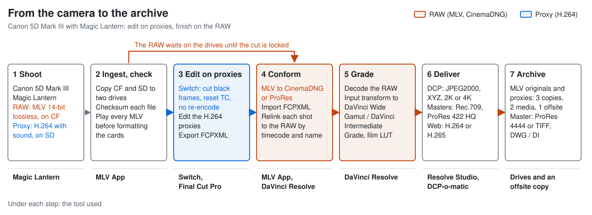
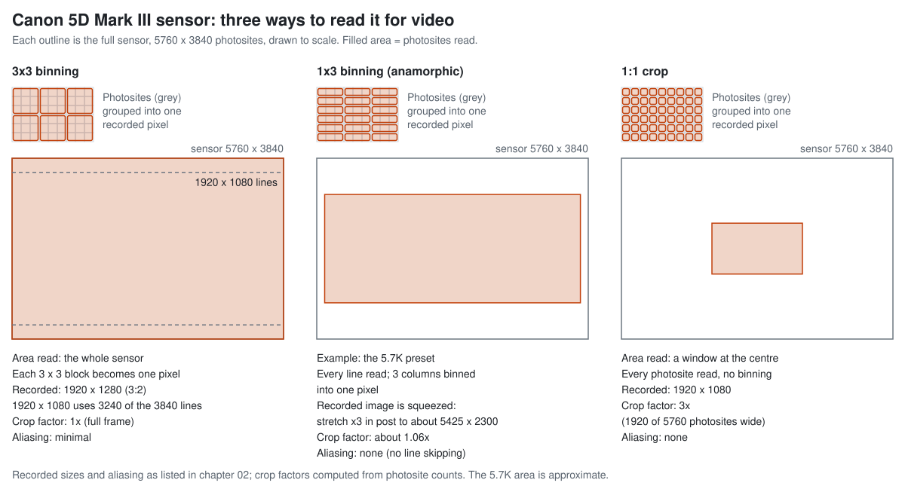

# 03. RAW post-processing: from MLV to image

[Back to the README](../README.md) · Previous: [02. Magic Lantern on the 5D Mark III](02-magic-lantern-5d-mark-iii.md) · Next: [04. Offline, online, conform and grading](04-offline-online-conform-and-grading.md)

## July 2017: 20 hours of rushes to convert

In July 2017 I was preparing a documentary with about 20 hours of rushes, shot on the 5D Mark III in compressed 14-bit RAW, 1920x1080 at 24p. Before the edit I tried the converters of the time. Footage had no batch processing. MLV Producer did not read compressed 14-bit. RawMagic was out of date. MLVFS was too slow in Resolve for that volume. Switch, the macOS app by Danne, was the one that worked reliably for transcoding, and I wrote it on the forum that day ([#17](https://www.magiclantern.fm/forum/index.php?topic=15108.msg187677#msg187677)).

The tools have changed since, but the problem is the same. The camera writes `.MLV` files: raw sensor values, with metadata and sound. Before you can edit or grade, something has to clean these values and turn them into an image. This chapter goes through that step, in the order I apply the corrections, and then tool by tool.

## How the tools are sorted

Every tool is in one of the three groups defined in the [README](../README.md): **What I have shot with** (used on a real shoot), **Reliable, on my test list** (reported to work by others or by the code, not yet used by me on a film) and **Not ready** (exists, but not usable on a shoot today).

Versions and dates were read on each project's page on 24 November 2026.

## The corrections, in order

Some defects live in the raw sensor values, at fixed places on the sensor or in fixed columns. They have to be fixed before demosaicing, because demosaicing spreads every value onto its neighbours and a single bad pixel becomes a coloured spot. Noise and aliasing are treated after, on the image.

### 1. Dead, hot and focus pixels

Every sensor has a few pixels that are stuck or too bright. Some bodies, the 100D, 650D, 700D and EOS M among them, also have phase-detect pixels on the sensor, and in RAW video they show as a pattern of pink dots. I was worried about them before a 100D project in 2017 ([#81](https://www.magiclantern.fm/forum/index.php?topic=16040.msg192699#msg192699)).

In August 2017 I had a blue spot on a 5D Mark III shot developed through MLVFS ([#37](https://www.magiclantern.fm/forum/index.php?topic=13152.msg188836#msg188836)). Danne proposed a pixel map in Switch, made with ImageJ ([#38](https://www.magiclantern.fm/forum/index.php?topic=13152.msg188843#msg188843)). Around the same time I saw hot pixels on the H.264 proxies, and pink in the highlights in 10 and 12-bit ([#44](https://www.magiclantern.fm/forum/index.php?topic=19300.msg189349#msg189349), [#52](https://www.magiclantern.fm/forum/index.php?topic=15108.msg189542#msg189542)).

Today MLV App fixes focus and bad pixels, with autodetection of the camera's focus pixel map ([MLV App README](https://github.com/ilia3101/MLV-App)).

### 2. Dark frame subtraction

A dark frame is a clip shot with the lens cap on, at the same ISO, shutter and temperature as the real shot. It records the fixed pattern of the sensor at that moment, and you subtract it from the footage. I used it, mostly on the 7D. MLV App does the subtraction with an external dark frame or one stored inside the MLV, and can export an averaged frame to build a dark frame ([MLV App README](https://github.com/ilia3101/MLV-App)). In 2018 I put dark frame and dot removal in the list of pre-corrections I described to the author of Fast CinemaDNG ([#136](https://www.magiclantern.fm/forum/index.php?topic=19021.msg205457#msg205457)).

### 3. Vertical stripes and pattern noise

Canon sensors of this generation show faint vertical stripes, from the column readout. They are visible in flat, dark areas and after a strong grade. I corrected them in MLV App and with the tools of the time. MLV App has a vertical stripes correction and a pattern noise reduction among its RAW corrections. These corrections stay in the CinemaDNG that MLV App exports; the creative settings do not ([guide, section 1](../ML-RAW-Workflows-Resolve-FCP.md)).

### 4. Demosaicing

The sensor sees one colour per pixel through a Bayer filter. Demosaicing rebuilds the three colours for each pixel. MLV App offers None, Simple, AHD, bilinear and AMaZE, plus LMMSE, DCB, RCD and IGV from the [librtprocess](https://github.com/CarVac/librtprocess) library ([MLV App README](https://github.com/ilia3101/MLV-App)). In 2018 I asked masc which one to use. His answer: "Mostly AMaZE is the best demosaic algorithm" ([#145](https://www.magiclantern.fm/forum/index.php?topic=20025.msg205579#msg205579)). I asked questions about IGV and LMMSE too, but I never made a proper comparison ([#143](https://www.magiclantern.fm/forum/index.php?topic=20025.msg205569#msg205569)).

### 5. Denoising

I denoise after demosaicing, in the edit or grading software, with [Neat Video](https://www.neatvideo.com/). It's commercial software, a plugin for DaVinci Resolve, Final Cut Pro, Premiere Pro and other hosts. Version 6.1.5 came out on 18 November 2026. It builds a noise profile from the shot and reduces noise, grain and flicker. I think it's excellent, and it's in my chain. Resolve also has its own temporal and spatial noise reduction; the settings I use for ML RAW are in the [guide](../ML-RAW-Workflows-Resolve-FCP.md).

### 6. Aliasing

In its full-frame video modes the 5D Mark III doesn't read every pixel of the sensor, and fine patterns can turn into moiré. The best fix is in the camera: the 1:1 crop modes read every pixel and alias much less. They are described in [chapter 02](02-magic-lantern-5d-mark-iii.md).

On the 7D I used a VAF optical filter by Mosaic Engineering, every day ([#68](https://www.magiclantern.fm/forum/index.php?topic=25880.msg191823#msg191823)). It has limits: with wide lenses it doesn't work well, and it softens the picture ([#121](https://www.magiclantern.fm/forum/index.php?topic=20025.msg195664#msg195664)).

In post, Danne and a1ex had a script that reduces aliasing with enfuse and hugin. I found the result impressive and asked if it could take TIFF as input; Danne wrote a TIFF version ([#92](https://www.magiclantern.fm/forum/index.php?topic=21089.msg193627#msg193627), [#93](https://www.magiclantern.fm/forum/index.php?topic=21089.msg193655#msg193655)). I also asked for antialiasing inside MLV App ([#118](https://www.magiclantern.fm/forum/index.php?topic=20025.msg195606#msg195606)).

## MLV App

**Group: What I have shot with.**

[MLV App](https://github.com/ilia3101/MLV-App) is the main tool for MLV files: free, GPL-3.0, for macOS, Windows and Linux. The current version is [1.16, released on 2 June 2026](https://github.com/ilia3101/MLV-App/releases/tag/Qtv1.16). It brought a new Dual ISO algorithm ("much faster and much better quality"), faster preview, a better histogram, mcraw fixes, stretch factors 1.25x and 2.0x, and support for the EOS 200D.

What I used it for: export to ProRes 4444 in C-Log in 2018 ([#166](https://www.magiclantern.fm/forum/index.php?topic=15108.msg206833#msg206833)), and the FCPXML workflow, which I tested end to end in August 2018 (see [chapter 04](04-offline-online-conform-and-grading.md)).

A few facts about the current versions:

- **Apple Silicon** is supported natively since [version 1.14](https://github.com/ilia3101/MLV-App/releases/tag/QTv1.14) (4 July 2022).
- **AgX** is older than version 1.14, whose notes say "AgX: Hugely improved reproduction of saturated colours". It's based on Troy Sobotka's AgX display transform, and it helps a lot under RGB LEDs and saturated light, with fewer clipped colours and no cyan highlights.
- **Profiles**: the source code defines twelve default image profiles (`PROFILE_` constants in [raw_processing.h](https://github.com/ilia3101/MLV-App/blob/master/src/processing/raw_processing.h)), among them Alexa Log-C, Cineon, S-Log 3, Canon Log, F-Log and DaVinci Wide Gamut Intermediate. [Version 1.15](https://github.com/ilia3101/MLV-App/releases/tag/QTv1.15) (19 March 2025) added Fuji F-Log, Panasonic V-Log and Canon Log. For Resolve, export CinemaDNG, or ProRes with the DaVinci Wide Gamut profile.
- **Speed**: in 2018 masc wrote that MLV App ran 100% on the CPU ([#145](https://www.magiclantern.fm/forum/index.php?topic=20025.msg205579#msg205579)). In 2019 I proposed to help financially for a CUDA option ([#193](https://www.magiclantern.fm/forum/index.php?topic=23738.msg214476#msg214476)). I didn't write any code.

## Dual ISO

**Group: Reliable, on my test list.**

Dual ISO reads alternate pairs of lines at two different ISOs, for example 100 and 1600, in the same frame. In post the two are merged into one image with more range in the highlights and the shadows, at the cost of vertical resolution and some aliasing. The module is described in [chapter 02](02-magic-lantern-5d-mark-iii.md).

My own history with it is mixed. In 2018 I tried LMMSE in RawTherapee on a Dual ISO shot from the 5D Mark III, and it didn't work well ([#158](https://www.magiclantern.fm/forum/index.php?topic=19300.msg206101#msg206101)). The same year I wrote that Dual ISO in documentary is an amazing feature ([#177](https://www.magiclantern.fm/forum/index.php?topic=22895.msg207058#msg207058)). The dynamic range figures I give in [chapter 02](02-magic-lantern-5d-mark-iii.md) are my own estimates. Measured charts are on [Photons to Photos](https://www.photonstophotos.net/Charts/PDR_MagicLantern.htm).

The reason to retest now: the Dual ISO processing was rewritten in MLV App 1.16, and on 2 October 2026 a fix for Dual ISO line skipping went into the Magic Lantern source for the 100D, 650D, 700D and EOS M ([commit list](https://github.com/reticulatedpines/magiclantern_simplified/commits/dev)). Dual ISO can also be processed in Switch, and some of the new virtual drives below merge it on the fly.

## Switch

**Group: What I have shot with.**

Switch is Danne's macOS app for processing MLV files. In 2017 and 2018 it did most of my transcoding: cleaning the H.264 proxies, timecode, CinemaDNG for the conform ([#47](https://www.magiclantern.fm/forum/index.php?topic=15108.msg189435#msg189435) to [#57](https://www.magiclantern.fm/forum/index.php?topic=15108.msg189608#msg189608), [#151](https://www.magiclantern.fm/forum/index.php?topic=15108.msg205968#msg205968), [#168](https://www.magiclantern.fm/forum/index.php?topic=15108.msg206885#msg206885)). Its history with the proxy workflow is in [chapter 04](04-offline-online-conform-and-grading.md). Danne's older builds were on Bitbucket and were deleted; his current Magic Lantern work is on [GitHub](https://github.com/dannephoto). On a recent Mac, be careful: in autumn 2026 a user reported on the forum that MLVFS, launched from Switch, failed on an iMac with macOS Sequoia ([Switch thread](https://www.magiclantern.fm/forum/index.php?topic=15108.msg249148#msg249148)).

## MLVFS and the new virtual drives

**MLVFS. Group: What I have shot with.** MLVFS mounts MLV files as folders of CinemaDNG, made on the fly as the software reads them, with no conversion and no extra disk space. In 2017 I used it for the virtual CinemaDNG I conformed in Resolve ([#34](https://www.magiclantern.fm/forum/index.php?topic=20025.msg188610#msg188610), [#131](https://www.magiclantern.fm/forum/index.php?topic=19021.msg205340#msg205340)). My note at the time: "Mlvfs is perfect for post-processing... too slow for preview" ([#27](https://www.magiclantern.fm/forum/index.php?topic=9560.msg188504#msg188504)). The [original repository](https://github.com/davidmilligan/MLVFS) has not moved since 31 May 2016, and the same user reported that he could no longer install it on macOS Sequoia ([MLVFS thread](https://www.magiclantern.fm/forum/index.php?topic=13152.msg249140#msg249140)). I don't recommend it for a new project.

In autumn 2026 three projects appeared that do the same thing on current systems. **Group for all three: Reliable, on my test list.** All are version 0.x and a few weeks old.

| Tool | What it does | Machines | Version (date) | Licence |
|---|---|---|---|---|
| [MLV Drive](https://github.com/bouncyball-git/mlvdrive) (bouncyball) | MLV clips shown as a drive of CinemaDNG sequences, for Resolve or any raw-capable app | Windows (WinFsp); macOS 26 or later through FSKit, no macFUSE, no kernel extension; Linux planned | 0.9.1 (22 Nov 2026), "work in progress" | GPL-3.0 |
| [CineFS](https://github.com/ozcancelik/CineFS) (ozcancelik) | MLV, MotionCam's `.mcraw` and, experimentally, `.braw` mounted as CinemaDNG folders for Resolve, Premiere and After Effects; focus pixel, bad pixel and stripe corrections built in | macOS 13 or later (Apple Silicon and Intel), through the NFS client built into macOS; Windows 10/11 through WinFsp | 0.2.0 (22 Nov 2026), "early release" | Apache-2.0 |
| [mlv2Resolve](https://github.com/julienbeka/mlv2Resolve) (julienbeka) | Mounts MLV as CinemaDNG, prepares a Resolve project, Dual ISO modes, can sync SenseFlow A1 gyro data for Gyroflow | Apple Silicon, macOS 14 or later, needs FUSE-T; tested with Resolve Studio 21.1.1 | 0.2.15 (1 Nov 2026) | GPL-3.0 |

A second, unrelated project is also called [MLV Drive](https://github.com/charlie-schomp/MLVDrive) (charlie-schomp, GPL-2.0, 0.4.3 on 6 November 2026). Its author says it is used every day with Resolve on Windows, while the Mac and Linux builds have only passed a mount test.

What I want to know from the test: whether Resolve plays these virtual folders in real time from an external drive, and whether the corrections match what MLV App does on the same clip.

## Fast CinemaDNG

**Group: Reliable, on my test list.**

[Fast CinemaDNG Processor](https://www.fastcinemadng.com/) by Fastvideo does the whole processing on an NVIDIA GPU with CUDA: it reads MLV directly, including spanned files, does dark frame subtraction, bad pixel correction, demosaicing with its own MG algorithm, denoising, and exports ProRes or image sequences, with real-time playback of CinemaDNG. It runs on Windows 10 64-bit and needs an NVIDIA GPU (GTX 10xx or newer, driver 572.83 or later). Linux (Ubuntu 22.04) is listed as under development. There is no macOS version, and it's commercial software. The site gives no version number.

I had a long exchange with its author in 2018 ([#122](https://www.magiclantern.fm/forum/index.php?topic=19021.msg204694#msg204694) to [#139](https://www.magiclantern.fm/forum/index.php?topic=19021.msg205468#msg205468)). I asked for an import of the edit's XML, so that only the shots in the cut get developed ([#135](https://www.magiclantern.fm/forum/index.php?topic=19021.msg205392#msg205392)). He answered that it was a viable idea but couldn't say when it would be ready ([#136](https://www.magiclantern.fm/forum/index.php?topic=19021.msg205457#msg205457)). I gave feedback; I didn't write code for it. On a Mac it's out of reach. On a Windows tower with an NVIDIA card it's worth testing for large volumes.

## vkdt

**Group: Reliable, on my test list.**

[vkdt](https://github.com/hanatos/vkdt) is a raw processor by hanatos, written on Vulkan, BSD-2-Clause. Version 1.0.0 is from 13 December 2025, with nightly builds since (the last one on 23 November 2026). Its `i-mlv` module does "real time magic lantern raw video (mlv) processing", with code taken from MLV App. It also reads MotionCam's MCRAW (`i-mcraw`), has a network that denoises and demosaics in one pass (`jddcnn`), a film simulation module (`filmsim`, see [chapter 05](05-film-looks-and-restoration.md)) and a video output (`o-vid`). Binaries exist for Linux (x86-64 and ARM) and Windows. On a Mac, Intel or Apple Silicon, you compile it yourself with Homebrew and LunarG's Vulkan SDK.

## Kinochrome

**Group: Not ready.**

[Kinochrome](https://git.sr.ht/~grego/kinochrome) is a RAW video processor on the GPU, by grego, AGPL-3.0, written in Rust with Vulkan. It opens uncompressed and losslessly compressed MLV and CinemaDNG, corrects focus pixels, plays in real time and exports through ffmpeg. Dual ISO on the GPU is planned. Its author says it is in alpha. There is no release; the last push to the [GitHub mirror](https://github.com/grego/kinochrome) is from 6 September 2026.

## Still frames: darktable and RawTherapee

**Group: Reliable, on my test list.**

Sometimes I need one frame as a photo: for a poster, a still for the press, or a photogrammetry test. A single DNG from MLV App opens in a photo raw developer.

- [darktable](https://github.com/darktable-org/darktable), GPL-3.0, version 5.6.2 (4 October 2026). [Version 5.6.0](https://www.darktable.org/2026/06/darktable-5.6.0-released/) added a "neural restore" module with raw denoise, denoise and 2x/4x upscale, running on ONNX; the AI features are off by default. The same notes list CinemaDNG lossless (Blackmagic, some DJI) among the compression modes it doesn't read. They don't say whether this covers MLV App's lossless DNG; an uncompressed DNG export avoids the question.
- [RawTherapee](https://github.com/Beep6581/RawTherapee), GPL-3.0, version 5.13 (26 July 2026). It's where I tried LMMSE on a Dual ISO frame in 2018 ([#158](https://www.magiclantern.fm/forum/index.php?topic=19300.msg206101#msg206101)).

What these do on one frame is not a guarantee for a shot. A denoiser or an upscaler that works image by image can change from one frame to the next, and in motion that shows as flicker. More on this in [chapter 05](05-film-looks-and-restoration.md).

## Summary by group

| Group | Tools |
|---|---|
| What I have shot with | MLV App, Switch, MLVFS (in 2017-2018), Neat Video |
| Reliable, on my test list | Dual ISO with MLV App 1.16, MLV Drive, CineFS, mlv2Resolve, Fast CinemaDNG, vkdt, darktable, RawTherapee |
| Not ready | Kinochrome |

[Back to the README](../README.md) · Previous: [02. Magic Lantern on the 5D Mark III](02-magic-lantern-5d-mark-iii.md) · Next: [04. Offline, online, conform and grading](04-offline-online-conform-and-grading.md)
