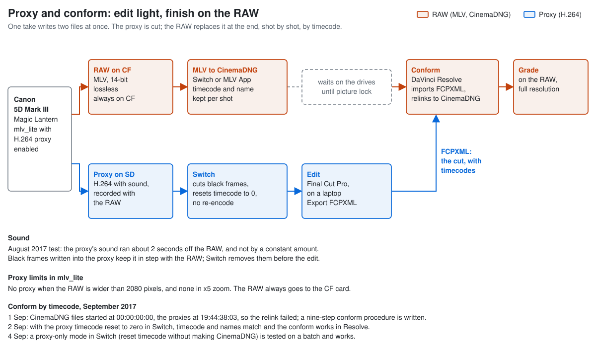
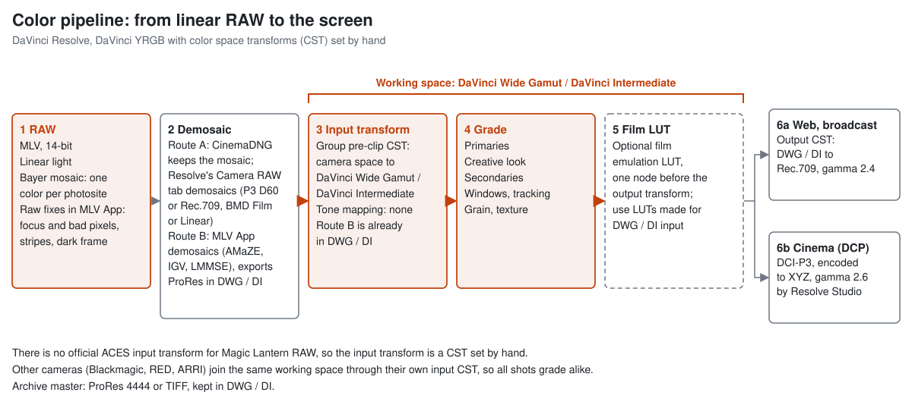

# 04. Offline, online, conform and grading

[Back to the README](../README.md) · Previous: [03. RAW post-processing](03-raw-post-processing.md) · Next: [05. Film looks and restoration](05-film-looks-and-restoration.md)

## The principle

You edit in low definition, straight out of the camera, and you finish in high definition. The edit is done on light files that any laptop plays. When the cut is locked, you go back to the RAW only for the shots that are in the film, and you grade and deliver from there. This is the offline/online workflow, and most of the cinema industry works like this.

I worked this way with the Blackmagic Cinema Camera in 2013: CinemaDNG into Resolve, ProRes 422 proxies, edit on any NLE, XML back to Resolve, conform on the DNG, grade in RAW. I described it on the Magic Lantern forum the same year, when RAW video arrived on the 5D Mark III ([#4](https://www.magiclantern.fm/forum/index.php?topic=5508.msg38705#msg38705)). With Magic Lantern it took four more years to get there.

## Summer 2017: a documentary in India

In the summer of 2017 I shot a feature documentary in India on the 5D Mark III in RAW. I shot on a monopod with an electronic viewfinder, in heat around 40 °C. The camera showed its temperature warning and kept going. Almost everything was shot on the 24-105 mm f/4, with some shots on a 50 mm f/1.8.

Before leaving, I expected about 20 hours of rushes in compressed 14-bit RAW, 1920x1080 at 24p ([#17](https://www.magiclantern.fm/forum/index.php?topic=15108.msg187677#msg187677)). Converting all of it to CinemaDNG or ProRes 4444 before the edit was too slow and needed too many drives. This shoot is what started the work with Danne that summer.

The sequence, with the dates of the forum posts:

- **13 August 2017.** I tested the H.264 proxy that Magic Lantern can record with sound, in parallel with the compressed 1080p RAW. It worked, but the H.264 files were longer than the RAW, with an offset of about 2 seconds that changed from clip to clip ([#21](https://www.magiclantern.fm/forum/index.php?topic=19300.msg188451#msg188451)). I was shooting in India at that moment ([#25](https://www.magiclantern.fm/forum/index.php?topic=20025.msg188477#msg188477)).
- **16 August 2017.** My chain at that time: lossless MLV plus H.264 proxies with sound; offload with an rsync checksum; visual check in MlRawViewer or MLV App; MLVFS for virtual CinemaDNG and the RAW corrections; Resolve 14 with a Cinelog or Alexa LUT, sound synced from the proxies, export to ProRes 4444 XQ; then proxies in Final Cut Pro X, the edit, and back to Resolve to grade and export ([#34](https://www.magiclantern.fm/forum/index.php?topic=20025.msg188610#msg188610)). It worked, but every shot went through ProRes 4444 before the edit.
- **Late August 2017.** In the camera, a1ex found a way to keep the H.264 proxy in sync with the RAW stream by making the extra frames black ([#40](https://www.magiclantern.fm/forum/index.php?topic=19300.msg189190#msg189190)). Danne added the removal of these black frames in Switch.
- **1 September 2017.** I asked Danne for a trimmed H.264 file with its sound and no black frames, without re-encoding, to edit offline and conform later on CinemaDNG from MLVFS ([#47](https://www.magiclantern.fm/forum/index.php?topic=15108.msg189435#msg189435)). The same day I found the real problem: the timecode. The Canon proxy had a timecode of 19:44:38:03 and the DNG from Switch started at 00:00:00:00. Danne wrote that he never worked with proxies himself and asked for a workflow, so I wrote the conform procedure in nine steps, tested with a Blackmagic CinemaDNG clip ([#49](https://www.magiclantern.fm/forum/index.php?topic=15108.msg189502#msg189502)).
- **2 September 2017.** First successful conform in Resolve, with CinemaDNG from Switch and from MLVFS: "TC + name are matching". I asked for an option that only fixes the proxy, without generating CinemaDNG, so that only the clips used in the edit are converted at the end ([#51](https://www.magiclantern.fm/forum/index.php?topic=15108.msg189532#msg189532)). Danne answered that it could be an option ([#52](https://www.magiclantern.fm/forum/index.php?topic=15108.msg189542#msg189542)).
- **4 September 2017.** I tested the new version of Switch with the proxy-only mode, and it worked ([#56](https://www.magiclantern.fm/forum/index.php?topic=15108.msg189604#msg189604)).

The procedure from 1 September, as I wrote it then:

1. One folder with the MLV files and the MOV proxies.
2. Run Switch to get new files without the black frames.
3. Import the proxies in Final Cut Pro X and edit: cuts, trims, change the order.
4. Export an XML.
5. Open Resolve.
6. Import the DNG.
7. Import the XML.
8. In the dialog, untick "Automatically import source clips into media pool".
9. If Resolve relinks to the DNG and the timeline matches the edit, the conform works.

The same steps work with any NLE that exports XML.

**What it saved.** My own calculation at the time, for 10 hours of footage at 1080p 23.976: uncompressed MLV plus a CinemaDNG transcode, about 5.6 TB; compressed MLV plus H.264 proxies, about 1.94 TB ([#55](https://www.magiclantern.fm/forum/index.php?topic=15108.msg189589#msg189589)). With the proxy-only mode and keeping the original proxies, about 2.1 TB ([#56](https://www.magiclantern.fm/forum/index.php?topic=15108.msg189604#msg189604)).

I used the same workflow on a 30-minute documentary with 12 hours of rushes, shot with the crop_rec_4k build. Syncing and stamping the timecode in Switch took less than 30 minutes, because nothing was transcoded. The sound was edited and mixed in Pro Tools, and the pictures were conformed in Resolve on MLVFS with an XML ([#71](https://www.magiclantern.fm/forum/index.php?topic=25880.msg191868#msg191868)). The proxies were also useful on set, to play back a shot in real time and judge an actor's performance ([#98](https://www.magiclantern.fm/forum/index.php?topic=25880.msg195495#msg195495)).

## 2018: FCPXML in MLV App

In 2018 I asked for the Switch proxy workflow inside MLV App ([#99](https://www.magiclantern.fm/forum/index.php?topic=20025.msg195496#msg195496)). In August masc released an FCPXML import in MLV App. I tested it on the same day with EOS M footage ([#141](https://www.magiclantern.fm/forum/index.php?topic=20025.msg205554#msg205554)):

1. Export proxies from MLV App.
2. Import them in Final Cut Pro X and edit.
3. Export an FCPXML.
4. Import it in MLV App and use the FCPXML assistant to point to the MLV files: OK.
5. Export the corrected MLV clips to ProRes 4444: OK.
6. Import the FCPXML in Resolve, which points to the ProRes 4444 and keeps the edit: OK.

What failed: exporting an FCPXML from that Resolve timeline and importing it back in MLV App. masc fixed it the same day ([#142](https://www.magiclantern.fm/forum/index.php?topic=20025.msg205563#msg205563)). In October 2018, Danne's proxy integration came into MLV App, and I called it "super cool" ([#188](https://www.magiclantern.fm/forum/index.php?topic=20025.msg207530#msg207530)).

Today MLV App has two FCPXML assistants. The Import Assistant finds the MLV files used as proxies in an NLE project. The Selection Assistant selects the MLV files that were or were not used ([MLV App README](https://github.com/ilia3101/MLV-App)). Since 1.15 it also reads Premiere XML through the same import. This is the cleanest version of the 2017 idea: edit on proxies, develop only the shots in the cut.

## The chain I use now

The steps of the conform, the Resolve project settings and the node tree are in the guide in this repository, [ML-RAW-Workflows-Resolve-FCP.md](../ML-RAW-Workflows-Resolve-FCP.md). I don't copy them here. The sections to read:

- [4. Conform workflow (offline/online)](../ML-RAW-Workflows-Resolve-FCP.md#4-conform-workflow-offlineonline), for FCPXML export, import in Resolve and relink;
- [3. Color grading pipeline for ML RAW](../ML-RAW-Workflows-Resolve-FCP.md#3-color-grading-pipeline-for-ml-raw), for the node tree;
- [Part 2: Final Cut Pro with ML RAW](../ML-RAW-Workflows-Resolve-FCP.md#part-2-final-cut-pro-with-ml-raw), for the ways to bring ML RAW into Final Cut Pro.

The chain, step by step:

1. **Edit in Final Cut Pro** on proxies: the H.264 recorded by the camera, or ProRes proxies exported from MLV App.
2. **Export an FCPXML** of the locked cut.
3. **Develop only the shots in the cut**, with the FCPXML assistant in MLV App, to CinemaDNG or ProRes 4444.
4. **Conform in DaVinci Resolve** on the developed files.
5. **Grade in Resolve** in a wide working space.
6. **Deliver** from Resolve (see [chapter 08](08-delivery-and-archiving.md)).

### The color pipeline in Resolve

For grading I work in a wide, scene-referred space, and I convert to the display space only at the end. The usual setup in Resolve is the "CST sandwich": a Color Space Transform node at the start of the tree, from the camera space into DaVinci Wide Gamut / DaVinci Intermediate; the grade in the middle, in that space; and a second Color Space Transform at the end, to Rec.709 or P3 for the screen. A film look or a print LUT goes before this output transform. The guide gives the full node tree.

The CinemaDNG from MLV App carries the RAW corrections, but not the creative settings, so the grade starts in Resolve's Camera RAW tab.

ML RAW also cuts together with cinema cameras. Parts of my film Ondes Noires (2017) were shot in RAW with Magic Lantern and edited with images from a Blackmagic camera and a RED Dragon. The guide has a section on [matching ML RAW with other cameras](../ML-RAW-Workflows-Resolve-FCP.md#matching-ml-raw-with-other-cameras-bmd-red-arri).

## Editing driven by agents

Now part of my editing is driven by AI agents, through MCP, the protocol that lets an assistant call the tools of an application.

- **Final Cut Pro**: I use [SpliceKit](https://github.com/elliotttate/SpliceKit), by Elliott Tate, MIT licence, version 3.3.9 (29 August 2026). It runs inside Final Cut Pro and exposes an MCP server, so an agent can read the timeline, cut, add markers, apply effects and export FCPXML.
- **DaVinci Resolve Studio**: Blackmagic's [announcement of version 21.1](https://www.blackmagicdesign.com/media/partial/release/20260908-03) (8 September 2026) gives integration with AI assistants (Claude, Claude Code and ChatGPT Codex) and 20 new scripting APIs. Resolve Studio 21.1 comes with its own MCP server. I use it for one-off scripts, to read the scripting documentation of the installed version, and to write a DCTL or a LUT from a description. Next to it I use [samuelgursky/davinci-resolve-mcp](https://github.com/samuelgursky/davinci-resolve-mcp) (MIT, version 5.4.3 on 24 November 2026), a community server that wraps many operations of Resolve's scripting API in ready-made tools.

I am also building my own editing software, designed from the start for AI and agents, around two gestures, cut and generate, and it's not public.

[Back to the README](../README.md) · Previous: [03. RAW post-processing](03-raw-post-processing.md) · Next: [05. Film looks and restoration](05-film-looks-and-restoration.md)
