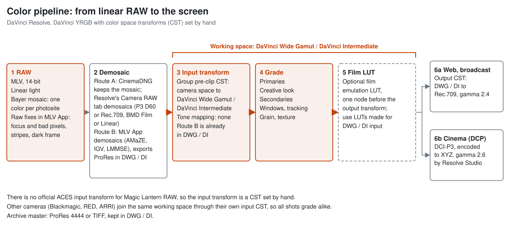

# 05. Film looks and restoration

[Back to the README](../README.md) · Previous: [04. Offline, online, conform and grading](04-offline-online-conform-and-grading.md) · Next: [06. Outlook and test list](06-outlook-and-test-list.md)

## The CineD article and the in-camera film looks

On 18 November 2026, CineD published [Magic Lantern for Canon DSLRs in 2026](https://www.cined.com/magic-lantern-canon-2026-raw-video-film-roll-soup-engine-m-film/), by Nino Leitner. The article put this repository next to three new projects that bring film looks into Canon cameras: Film Roll, Soup Engine and M-Film. I read their pages to see what they do for my camera, the 5D Mark III, and for RAW video.

They are made for photos. All of them work on the JPEG or on the still image, and none of them touches MLV video. I found no open film look designed for 5D Mark III RAW video. What exists for video is general: tools that emulate film on any linear or log image, which you then use in the grade. This chapter lists both, and a recipe I want to try.

The three groups (**What I have shot with**, **Reliable, on my test list**, **Not ready**) are defined in the [README](../README.md).

## Film looks in the camera (photo only)

| Project | What it does | 5D Mark III | Version, licence |
|---|---|---|---|
| [Film Roll](https://florinkiritescu.ro/film-roll-beta11/) by Florin Kiritescu | Film stocks applied to the JPEG in the camera, with rolls of 12, 24 or 36 frames; the RAW file is not touched | Firmware 1.2.3 (look on the shot, with halation) and 1.1.3 (developed after the shot); also 6D and 7D | Beta 1.1, free beta; 5 of the 15 stocks are free, donors get all of them |
| [The Ritual](https://latentstudios.art/firmware/) by Latent Studios | Film simulation firmware for photos | Firmware 1.2.3 or 1.3.6; also 5D and 5D Mark II | Pay what you want, 0 to 100 dollars |
| [M-Film](https://github.com/HNGSeries/mfilm-canon-film-simulation) | Film simulation for photos (CR2 and JPEG), nine stocks taken from spektrafilm | The compatibility table says firmware 1.1.3 and 1.2.3 work since 0.1.3, and that 0.2 is not yet confirmed on this camera | 0.2.4 (20 November 2026), GPL-2.0 |
| [Soup Engine](https://github.com/jiijii0/soup-engine) | Writes a second JPEG with the look next to the raw file | No port for the 5D Mark III; ports exist for the 5D, 5D Mark II, 6D, 7D and other bodies | Beta, GPL-2.0 |

**Group for all four, for my use: Not ready.** They may be very good for stills. For RAW video they do nothing, so they don't enter my chain.

MLV App itself lists "processing filters for film emulation powered by neural networks" among its features ([MLV App README](https://github.com/ilia3101/MLV-App)). I haven't used them on a film.

## A recipe to try: spectral film simulation in the grade

**Group: Reliable, on my test list.** This is a path I want to test. I have not done it on a film.

The idea: develop the MLV in MLV App as usual (see [chapter 03](03-raw-post-processing.md)), conform and grade in Resolve in a wide space (see [chapter 04](04-offline-online-conform-and-grading.md)), and put the film emulation in the grade, before the output transform.

The tools:

- **[spektrafilm](https://github.com/andreavolpato/spektrafilm)** by Andrea Volpato, GPL-3.0, version 0.3.3 (6 June 2026). It simulates a negative, a print and a scan from the manufacturers' data sheets, with halation and grain generated on the negative. It's written in Python and is the reference implementation of the model. Version 0.3.3 added `spektrafilm-lut`, a command line tool that bakes `.cube` LUTs. Read the licences of the profiles and LUTs in the repository before using them on a commercial project; they are not the same as the licence of the code.
- **[spektrafilm OFX](https://spektrafilm.114c.de/)** by Aedan, a plugin for DaVinci Resolve built on the same model. It's a free beta, for macOS (Metal), Windows and Linux (Vulkan). The [changelog](https://spektrafilm.114c.de/changelog) gives the current builds.
- **[vkdt](https://github.com/hanatos/vkdt)**, the raw processor from [chapter 03](03-raw-post-processing.md), has a `filmsim` module, a Vulkan implementation of the same model. vkdt also reads MLV directly, so in theory the whole chain from MLV to film look can run in one program.
- **[OpenDRT](https://github.com/jedypod/open-display-transform)** by Jed Smith, GPL-3.0, version 1.1.0 (22 January 2026). It's a display transform: it decides how the scene-referred image is mapped to the screen. It doesn't emulate a film stock. Its DCTL accepts DaVinci Wide Gamut and DaVinci Intermediate as input. I want to compare it with Resolve's own output transform under a film look.

What I want to check in the test: whether a LUT baked from spektrafilm and the OFX plugin give the same image on the same shot; how the grain behaves over a moving shot and not only on a still; and whether the look holds on 5D Mark III skin tones and on the highlights, which clip early.

## Film emulation LUTs and plugins

The guide in this repository has a section on [film emulation LUTs](../ML-RAW-Workflows-Resolve-FCP.md#film-emulation-luts) and where to place them in the node tree. A short list:

- Free: [Jamie Fenn's DWG LUTs](https://www.jamiefenn.com/p/free-dwg-film-emulation-luts/) (Kodak 2383 and Fuji 3510 for a DaVinci Wide Gamut workflow), [Juan Melara's print film emulation](https://juanmelara.com.au/blog/print-film-emulation-luts-for-download), and the Kodak print film LUTs that come with Resolve.
- Commercial: [CinePrint35](https://www.tombolles.net/cineprint35), [Dehancer](https://www.dehancer.com/), [FilmConvert](https://www.filmconvert.com/) Nitrate, [Filmbox](https://videovillage.com/filmbox/) by Video Village, and [Colourlab.ai](https://www.colourlab.ai/).

A print film emulation LUT expects a specific input, often a log film scan. Read each LUT's documentation before placing it.

## Grain

Grain is part of the film look, and it's also a way to cover the noise and the compression of a digital image. spektrafilm generates the grain on the negative, inside the simulation. Dehancer and FilmConvert have their own grain. Whatever the tool, I judge grain in motion, on the full-size image, and after the delivery encode, because a streaming codec can remove fine grain or turn it into blocks.

## Restoration, denoising and upscaling

My position on upscaling is old. In 2013, on the 7D, I wanted continuous 1920x1080 recording because an upscale is one more step in post, slower, and easy to get wrong in a professional edit ([#9](https://www.magiclantern.fm/forum/index.php?topic=7503.msg82625#msg82625), [#10](https://www.magiclantern.fm/forum/index.php?topic=7503.msg82679#msg82679)). In 2020 I wrote that it would be interesting to compare the 5.7K 1x3 mode with a 1:1 image upscaled to 5.7K with Topaz Video Enhance ([#205](https://www.magiclantern.fm/forum/index.php?topic=25214.msg229801#msg229801)). I never made that comparison on a film.

**What I have shot with**: [Neat Video](https://www.neatvideo.com/), commercial, for denoising (see [chapter 03](03-raw-post-processing.md)). It works over several frames, which matters for video.

**Reliable, on my test list**: the neural tools for raw images. The [neural restore module of darktable 5.6](https://www.darktable.org/2026/06/darktable-5.6.0-released/) denoises a raw frame, demosaics it and can upscale it 2x or 4x. vkdt has `jddcnn`, a network that denoises and demosaics in one pass. Both work well on still images.

**Not ready**, for me: using these neural tools on a moving shot. They treat each frame on its own. Nothing guarantees that two neighbouring frames get the same treatment, and in motion the difference shows as flicker or crawling texture. Video models trained for temporal consistency exist, but I haven't tested them on ML RAW. Until I have tested one on a real shot and watched it in motion, I keep them out of a film.

[Back to the README](../README.md) · Previous: [04. Offline, online, conform and grading](04-offline-online-conform-and-grading.md) · Next: [06. Outlook and test list](06-outlook-and-test-list.md)
