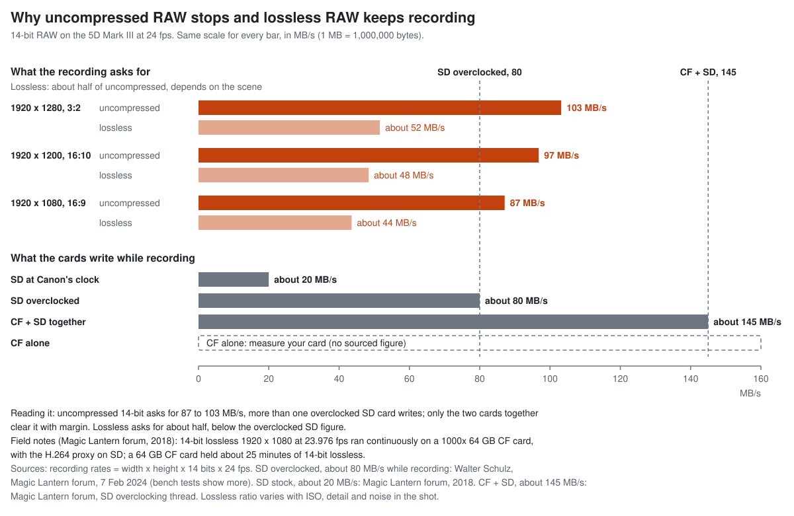

# 08. Delivery and archiving

[Back to the README](../README.md) · Previous: [07. AXIOM and open cinema](07-axiom-and-open-cinema.md) · Next: [09. On-set data](09-on-set-data.md)

## India, 2017: what RAW video weighs on disk

In August 2017, during the shoot in India, after each day I offloaded the cards and checked the copies with an rsync checksum ([#34](https://www.magiclantern.fm/forum/index.php?topic=20025.msg188610#msg188610)). A few weeks later I calculated what 10 hours of 1080p footage take on disk: about 5.6 TB for uncompressed MLV plus a CinemaDNG transcode, about 1.94 TB for compressed MLV plus H.264 proxies ([#55](https://www.magiclantern.fm/forum/index.php?topic=15108.msg189589#msg189589)). RAW video is heavy, and every format choice at the end of the chain decides how many drives you buy and what can still be opened in twenty years.

This chapter covers the end of the chain: the cinema copy, the open formats for the archive, and the delivery codecs. The settings for each delivery from Resolve are in the guide, section [5. Delivery from DaVinci Resolve](../ML-RAW-Workflows-Resolve-FCP.md#5-delivery-from-davinci-resolve).

## DCP with DCP-o-matic

A DCP (Digital Cinema Package) is the format cinemas and festivals play: JPEG 2000 images and PCM sound in MXF files, with XML files that describe the package. [DCP-o-matic](https://dcpomatic.com/) makes DCPs from almost any video, sound and subtitle files. It's free and open source (GPL-2.0, [source](https://github.com/cth103/dcpomatic)). The current stable version is 2.18.52, released on 21 November 2026 ([download page](https://dcpomatic.com/download)), for Windows, macOS and Linux.

The usual way with it: export a master from Resolve (a TIFF or DPX sequence with WAV files, or ProRes 4444), then build the DCP in DCP-o-matic. It also handles subtitles. Before sending a DCP to a festival, play it from start to end in DCP-o-matic's player, and if you can, in a cinema.

DCP-o-matic encodes JPEG 2000 on the CPU, and it can share the work with other machines on the network. Since October 2023 it can also use Grok, a GPU encoder written by Aaron Boxer ([announcement on the DCP-o-matic forum, 18 October 2023](https://dcpomatic.com/forum/viewtopic.php?p=11318)). The Grok core is open source (AGPL v3) and encodes on the CPU. The GPU encoder is a paid, closed plugin for Linux and Nvidia cards ([Grok](https://grokcompression.com/)). So DCP-o-matic is open, and its fastest encoder is closed.

## My history with DCP-o-matic

**Group: What I have shot with.** In May 2017 I tested DCP-o-matic for the Côté Court festival, to create DCPs and to use it as a player. In June 2021 I made a test DCP of Maalbeek with it, and it's still the tool I use for my DCPs.

In spring 2020, while I was working with Fastvideo on Fast CinemaDNG, I wrote for its founder, Fyodor Serzhenko, the specification of a GPU JPEG 2000 encoder for DCP: 2K and 4K, Interop and SMPTE, 24 fps, 250 Mbit/s, and the conversion to XYZ. He asked me to present his encoder to Carl Hetherington, the author of DCP-o-matic, and in June 2020 he sent Carl his SDK. Carl integrated it in two test branches of DCP-o-matic's own git repository, `fastvideo` in the summer of 2020 and `fastvideo2` in November 2021. Neither was merged into the main branch or released. The GPU encoding that DCP-o-matic did release, in 2023, is Grok, described above.

## Open formats for the archive

An archive format has to be readable without the company that made it. These are the open ones that matter for this chain.

- **CinemaDNG**: the camera original, once the MLV is developed. It's Adobe's DNG applied to image sequences, with an open specification. MLV App writes it, and it's what Resolve reads for the conform (see [chapter 03](03-raw-post-processing.md)). The MLV file itself is also documented: its format is in the Magic Lantern source, and several open programs read it.
- **FFV1**: a lossless intra-frame video codec from the FFmpeg project. Versions 0, 1 and 3 are published by the IETF as [RFC 9043](https://datatracker.ietf.org/doc/rfc9043/) (August 2021). The [Library of Congress format description](https://www.loc.gov/preservation/digital/formats/fdd/fdd000341.shtml) describes it as designed for long-term audiovisual preservation. It's usually stored in Matroska (`.mkv`), and FFmpeg encodes and decodes it.
- **OpenEXR**: the image format of visual effects and of the Academy Software Foundation, for linear, high bit depth images. Version 3.5.5 came out on 23 November 2026 ([GitHub](https://github.com/AcademySoftwareFoundation/openexr), BSD-3-Clause). It's a good container for frames that went through VFX, 3D or generation, where CinemaDNG doesn't apply.

A ProRes 4444 master is not an open format. It's what most of the industry exchanges, and I use it, but it depends on Apple. For the archive I would keep it next to an open copy.

## Delivery codecs: AV1

AV1 is a royalty-free video codec from the Alliance for Open Media, used for streaming and the web. The reference open encoder is [SVT-AV1](https://gitlab.com/AOMediaCodec/SVT-AV1), version 4.3.0, released on 2 November 2026. I would use AV1 for a platform or an online release, and keep the master in another format.

## IMF in two sentences

IMF (Interoperable Master Format, SMPTE ST 2067) is a master package that streaming platforms ask for, with one set of images and sound and separate versions for languages, subtitles and cuts. A festival or an independent release doesn't need it; if a platform asks for one, Netflix's open validator [Photon](https://github.com/Netflix/photon) and the open [IMF Tool](https://github.com/IMFTool/IMFTool) are the places to start.

## What to keep

For a film shot in ML RAW, the list of what I would keep, each with a checksum written next to it:

- the camera originals (MLV files, and the H.264 proxies with their sound);
- the edit project and the FCPXML of the locked cut;
- the Resolve project, and the developed CinemaDNG or ProRes 4444 of the shots in the cut;
- the final masters: the graded master, the DCP, and the sound mix as WAV stems.

Two copies on different drives, and one of them in another place, is the minimum. A checksum check after each copy is what tells you a copy is good; the copy finishing without an error doesn't.

[Back to the README](../README.md) · Previous: [07. AXIOM and open cinema](07-axiom-and-open-cinema.md) · Next: [09. On-set data](09-on-set-data.md)
