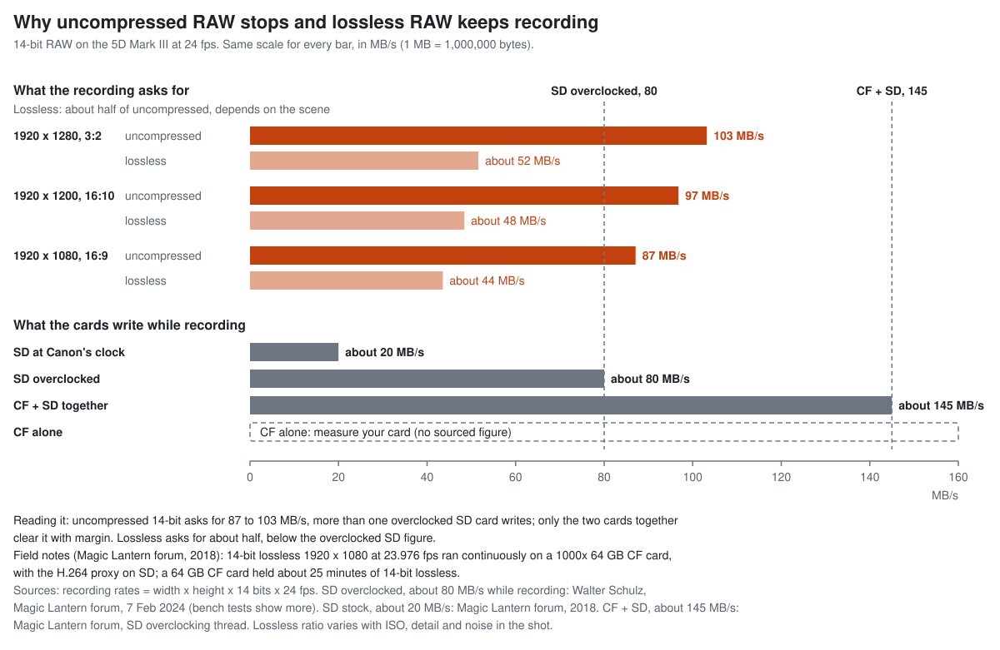

# 09. On-set data

[Back to the README](../README.md) · Previous: [08. Delivery and archiving](08-delivery-and-archiving.md) · Next: [10. Previs, 3D and generated images](10-previs-3d-and-generated-images.md)

## India, 2017: one copy is not a copy

In August 2017, during the shoot in India, I offloaded the cards after each day and checked the copies with an rsync checksum ([#34](https://www.magiclantern.fm/forum/index.php?topic=20025.msg188610#msg188610)). RAW video fills cards fast, and a card is reused the next morning. If the copy is wrong and the card is already formatted, the shot is gone.

A few weeks later I calculated what 10 hours of 1080p footage take on disk: about 5.6 TB for uncompressed MLV plus a CinemaDNG transcode, about 1.94 TB for compressed MLV plus H.264 proxies ([#55](https://www.magiclantern.fm/forum/index.php?topic=15108.msg189589#msg189589)). The format you choose on set decides how many drives you buy. The data rates of each Magic Lantern mode are in [chapter 02](02-magic-lantern-5d-mark-iii.md#resolution-modes-and-data-rates).

## How I copy rushes now

The rule hasn't changed since 2017: two verified copies on two different drives before a card is wiped. What changed is the checksum, the number of destinations, and the order in which things happen.

I published the protocol I use in [dit-backup-protocol](https://github.com/ismael-joffroy-chandoutis/dit-backup-protocol) (MIT). It's the public version of the pipeline I run on shoots, with machine names and credentials replaced by variables. The order is fixed:

1. Copy from the card to a first local drive, and compute an xxHash checksum in the same pass.
2. Copy over the network to a second machine, then check that its checksums are identical to the first ones.
3. Only after that, send the files to a cloud bucket and to a NAS, and check them again there.
4. Write a manifest of all the files and their checksums.

Two rules are strict. Nothing goes to the cloud before the local copies are verified. And never two reads or writes at the same time on the same hard drive.

On a production with a DIT, this job is usually done in a commercial tool such as Silverstack. My protocol does the same steps with open tools.

## Planning the storage before the shoot

[shoot-storage-calculator](https://github.com/ismael-joffroy-chandoutis/shoot-storage-calculator) (MIT) gives the cards and disks a shoot needs from the codec, resolution, frame rate and hours of rushes. It runs in the browser, or as a command line tool. ProRes figures come from Apple's published target bitrates. RAW and long-GOP figures are approximate, and the tool says so: check them with the camera manufacturer.

## The tools

| Tool | What it does | Licence | Version (24 November 2026) | Group |
|---|---|---|---|---|
| [rsync](https://rsync.samba.org/) | Copy with a checksum check | GPL-3.0 | | What I have shot with (India, 2017) |
| [xxHash](https://github.com/Cyan4973/xxHash) | Fast checksum (xxh64, xxh128) | BSD-2-Clause | 0.8.4, 19 September 2026 | What I have shot with |
| [rclone](https://github.com/rclone/rclone) | Copy and check against cloud storage and NAS | MIT | 1.76.0, 6 November 2026 | What I have shot with |
| [ASC MHL](https://github.com/ascmitc/mhl) | The Media Hash List of the American Society of Cinematographers: a standard file that records the chain of custody of each copy | MIT | 1.2, 4 July 2025 | Reliable, on my test list |

The repository has a script that writes an MHL manifest. I haven't checked its files against the ASC MHL reference tool yet. That check is on my test list, so that the manifest can be read by any post-production house.

## What I would keep from a shoot

The list is in [chapter 08](08-delivery-and-archiving.md#what-to-keep): camera originals with their sound, the edit project, the grade project, the masters. Each copy has its checksum next to it, and a copy counts when its checksum has been checked. A copy that finished without an error message isn't a checked copy.

[Back to the README](../README.md) · Previous: [08. Delivery and archiving](08-delivery-and-archiving.md) · Next: [10. Previs, 3D and generated images](10-previs-3d-and-generated-images.md)
